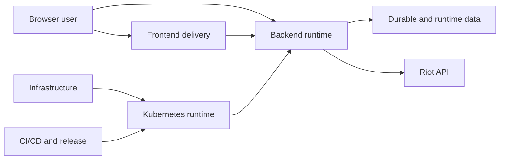
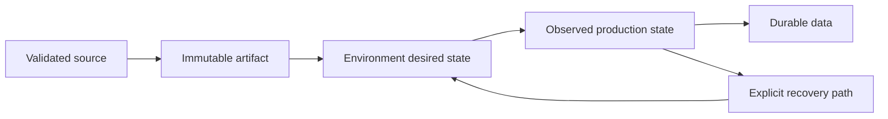

# WR.GG Public Architecture Documentation

This repository presents a concise, production-focused view of the
WINRATES.GG architecture. It is a sanitized portfolio document, not a copy of
the private implementation. It contains no credentials, Terraform state,
internal hostnames, private URLs, or operator-only recovery commands.

## Architecture Map

The concerns are intentionally separated by responsibility rather than by
private repository. A reader can understand what the system does first, then
how it is hosted, delivered, and operated.

## Concern Map

| Concern | Answers | Documentation |
| --- | --- | --- |
| Backend | How does the API acquire, protect, process, and serve Riot data? | [Backend runtime](docs/backend-runtime.md) |
| Frontend | How are the public site, SEO objects, and private dashboard delivered? | [Frontend delivery](docs/frontend-delivery.md) |
| Infrastructure | What cloud, storage, host, network, and access foundations exist? | [Infrastructure](docs/infrastructure.md) |
| Kubernetes | How are cluster objects composed, scheduled, and reconciled? | [Kubernetes runtime](docs/kubernetes-runtime.md) |
| CI/CD | How does validated source become an immutable production release? | [CI/CD and release](docs/ci-cd.md) |

## Lifecycle In One View

The most important boundary is between an artifact and desired state. Building
an artifact does not deploy it. Selecting a tag in desired state does not
rebuild it. Kubernetes reconciliation applies the selected state, while data
storage follows its own lifecycle.

## Production Reference

Production is the reference architecture. Staging intentionally uses the same
Terraform, Kubernetes, Helm, GitOps, and release shape in a separate AWS
account. Its differences are environment identity, credentials, domains, data,
and operational scale; it does not need a second architecture manual.

This is a production-like early beta rather than a claim of globally redundant
high availability. The design favors a small operating footprint, explicit
recovery paths, reproducible releases, and clear ownership boundaries.
