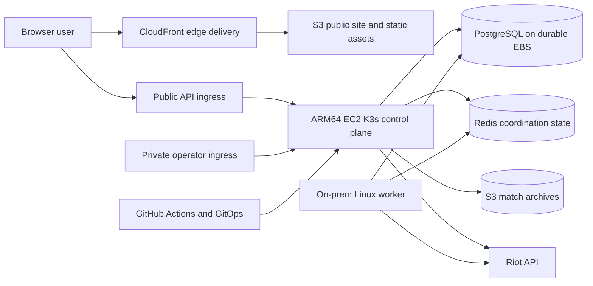
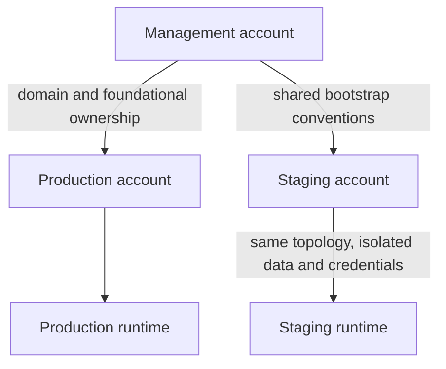
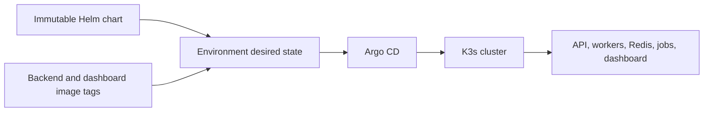
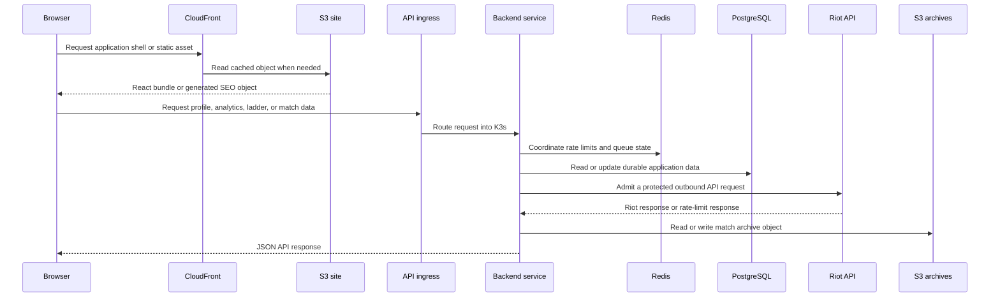

# Production Architecture

## Purpose

WINRATES.GG is a data-heavy League of Legends companion app. It combines
Riot API lookups, durable match data, static game assets, asynchronous
ingestion, and derived analytics into one user-facing product.

The production architecture is deliberately small but operationally serious:

- static web delivery is separated from runtime compute;
- durable application data is separated from temporary coordination state;
- background ingestion is separated from the API request path;
- deployment identity is separated from runtime observation;
- the cloud control plane and the on-prem worker have explicit boundaries.

## Production At A Glance

## Major Boundaries

### Browser Delivery

The public React application, hashed assets, SEO objects, favicons, and match
archive objects are served through S3 and CloudFront. This keeps static traffic
off the Kubernetes control plane and allows frontend publication to happen
independently from backend rollout.

### Runtime Compute

An ARM64 EC2 host runs the K3s control plane and the services that are required
for the application to function:

- API service
- Redis
- dashboard service and dashboard API
- cluster infrastructure and ingress
- database access through the attached persistent volume

The control plane is intentionally a small single-host operational boundary,
not a highly available Kubernetes control plane.

### Background Processing

An on-prem Linux host joins the K3s cluster as a worker. It is used for
non-critical and throughput-oriented work such as:

- match queue draining;
- ladder refresh;
- recurring analytics and asset jobs;
- static SEO generation.

The worker is attached through an explicit Ansible procedure and communicates
with the control plane over the private network overlay. If it is unavailable,
the API and core data services remain the primary recovery target.

### Durable Data

PostgreSQL is the system of record for application data and analytics. Its
storage is an EBS volume managed separately from the application deployment.
The volume can be retained, adopted, restored from a snapshot, or deliberately
destroyed through separate infrastructure operations.

Redis is shared coordination state. It supports rate-limit admission, temporary
blocks, queue coordination, and operational metrics. It is important to runtime
behavior but is not the durable source of truth for the product database.

S3 stores match archives, static assets, frontend releases, and generated SEO
objects. CloudFront provides the public edge delivery layer for those objects.

## Cloud Account Shape

The deployment uses separate AWS account boundaries for management,
staging, and production concerns. The exact account identifiers are omitted
from this public document.

Production owns the active application resources and authoritative runtime DNS
records. The management boundary exists because the domain and account
segregation predate the application architecture. That ownership history is
documented as an infrastructure constraint rather than hidden behind the
application design.

## Kubernetes Model

K3s provides the runtime substrate. Helm defines the application templates,
the GitOps repository selects immutable artifact versions, and Argo CD applies
the selected desired state.

The repository that owns Kubernetes desired state does not build application
artifacts. It selects the exact backend, worker, dashboard, and Helm releases.
This keeps artifact production and cluster reconciliation separate while still
making the final production revision auditable.

## Request And Data Flow

New Destiny provides the local rate-limit model and shared Redis coordination.
The application treats Riot's responses as the external source of truth while
using a respectful local model to reduce avoidable throttling and coordinate
multiple workers.

## Security Boundaries

- Public users reach static content through CloudFront and application data
  through the public API surface.
- The operations dashboard and Argo UI are private-network surfaces.
- AWS access is performed through environment-specific roles and GitHub OIDC
  rather than long-lived repository credentials.
- The on-prem worker uses SSM, Tailscale, and short-lived attachment state to
  join the selected environment.
- Riot API credentials are injected through environment-specific secret
  management and are not stored in the public frontend or documentation.

## Current Reliability Posture

This is a production-like early beta with explicit recovery, not a fully
redundant platform. The main constraints are intentional and visible:

- one primary control-plane host;
- one optional on-prem worker;
- one primary PostgreSQL volume;
- Redis is not presented as a durable database;
- production recovery depends on immutable releases, EBS retention, and
  operator-controlled restore procedures.

The design is therefore optimized for recoverability, low cost, and clear
failure boundaries rather than automatic multi-zone failover.

