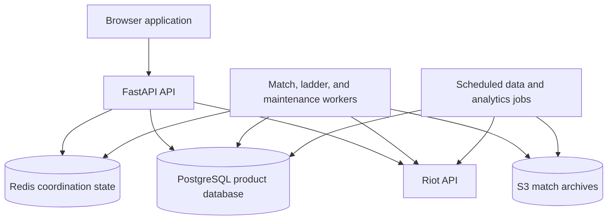

# Backend Runtime

## Purpose

The backend is the product runtime. It exposes the API used by the React
application, protects outbound Riot API traffic, persists durable product
facts, and runs the workers that turn external game data into searchable
analytics.

The backend repository owns the FastAPI source, database models and migrations,
worker modules, the backend Docker build context, and publication of the API
and worker image release. Kubernetes decides where those images run and how
many workload replicas exist.

## Runtime Shape

## API And Worker Boundary

The API is responsible for user-facing request orchestration and minimum
viable responses. It can enqueue longer work rather than making a browser
request wait for the entire ingestion path.

The worker image contains the same backend package but runs different modules:

- match queue draining;
- ladder and mastery refresh;
- data and icon refresh;
- archive reconciliation and cleanup;
- analytics and SEO publication.

This is one artifact with different Kubernetes workload configuration. The
separation avoids coupling API availability to background throughput while
keeping code and dependency versions aligned.

## Riot API Protection

New Destiny provides shared Redis-backed admission and temporary blocking for
the API and workers. The application models the communicated application,
service, and method limits per Riot routing value, then records internal and
external rate-limit outcomes separately.

The model is deliberately respectful rather than a claim of perfect knowledge
of Riot's implementation. An internal decision prevents a request before it
is sent. An external decision means Riot returned a throttle. The distinction
is observable in the private dashboard without making rate-limit metrics a
second application database.

## Database Lifecycle

Database schema changes are versioned with Alembic. Runtime startup does not
silently invent a schema; the initialization sequence applies migrations and
then runs idempotent seed and refresh jobs. Existing data is treated as durable
state, so destructive reset and snapshot restore are explicit infrastructure
operations rather than normal application deployment behavior.

## Failure Boundaries

- A backend image failure affects API and workers using that release, but an
  earlier immutable artifact can be selected without rebuilding.
- A worker failure delays ingestion and derived data, but should not make the
  public static shell unavailable.
- Redis loss affects coordination, rate limiting, queue state, and dashboard
  observations; it is not the durable product database.
- PostgreSQL failure affects durable product behavior and requires the explicit
  storage recovery path described in [Delivery and operations](delivery-and-operations.md).

## Source Of Truth

The backend repository is the source of truth for runtime behavior. The
published backend release is the source of truth for a deployable image. The
production `k8s-live` revision is the source of truth for which release is
requested.
