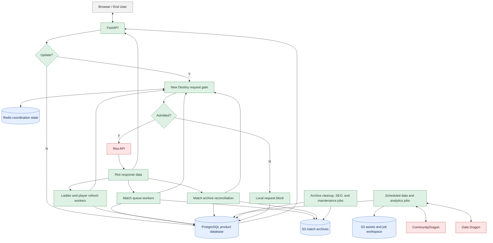
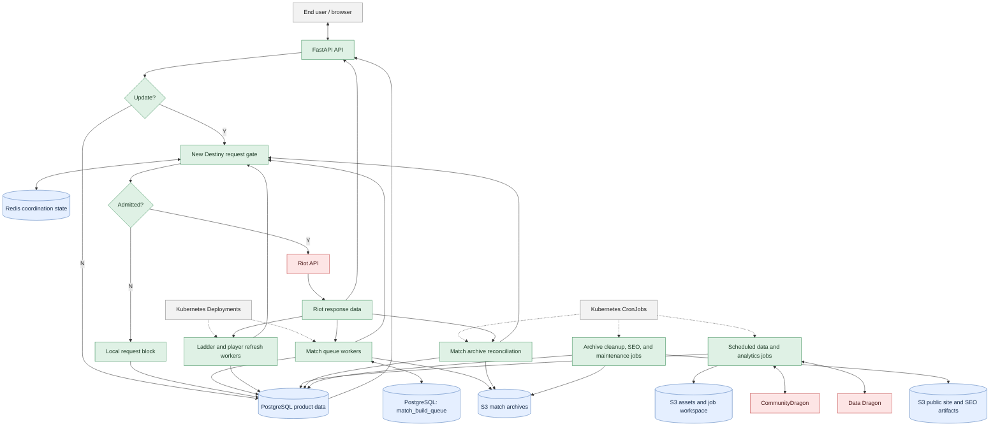
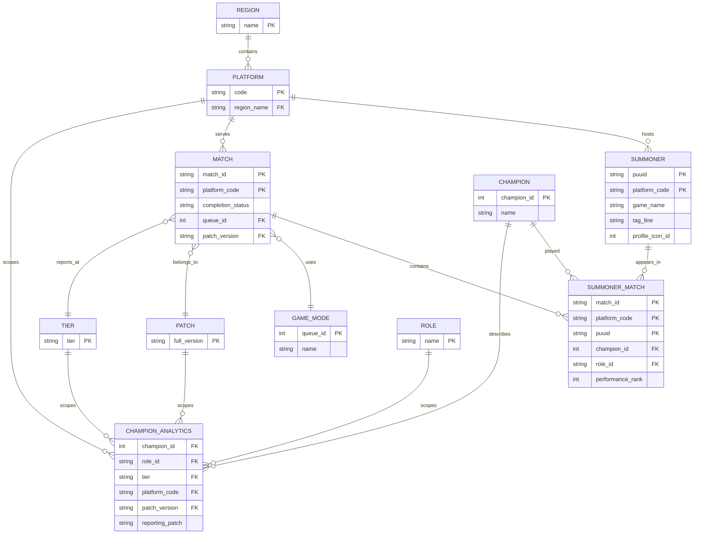
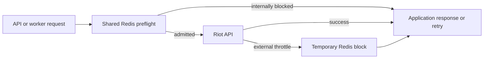

# Backend Runtime

## Purpose

At its core the WINRATES.GG (WR.GG) API, or `backend` implements a read-through cache that sits between UI application users and the various Riot Games APIs for League of Legends. WR.GG also augments Riot payloads and implements product- and domain-specific data ingesting, data cleaning, data normalization, data analysis, and data storage patterns. Beyond the core Riot APIs WR.GG also relies on with supporting Riot and third-party services such as Community Dragon which provide critical and ever-changing foundational information. Much of this automatic upkeep code uses the same data models and patterns as the API, so that logic is defined and bundled here as well.

## Primary Technology
The core API is written in the Python web framework FastAPI. FastAPI was selected when WR.GG was migrated out of Django because its async support and syntax were simpler for this workload. WR.GG relies on more than over 1 million external API calls per day to hydrate the baseline product, some of these calls happen concurrently inside the HTTP request-response cycle so the simplicity of FastAPI async path (endpoint) functions made it more attractive.

The first diagram is the compact dependency view. The second is the broader
system view: public delivery sits above the cloud and cluster platform, while
the backend runtime and its external dependencies sit below it.

## Diagram: Backend Runtime

Redis is a request-coordination dependency, not a requirement for every
worker. The API, match queue workers, ladder refresh workers, and archive
reconciliation use it through New Destiny when they make protected Riot
requests. Asset refresh, analytics, archive cleanup, SEO, and partition jobs
normally work against PostgreSQL, S3, or CommunityDragon without Redis.

The browser is only one API caller. Match, ladder, and archive-reconciliation
workers also enter the same New Destiny gate directly. Riot responses return to
the relevant WRGG component, which then serves the API response or persists
normalized data and archives.

The read-through profile flow has an explicit `update: bool` control. When
`update=False`, FastAPI reads the current durable state directly from
PostgreSQL. When `update=True`, it enters the New Destiny and Riot path; the
refreshed result is then returned to the API and persisted as product state
where the route owns durable data.

## Diagram: Backend By Initiator And Outcome

The diagram starts with the source of work rather than treating every request
as browser traffic. On an update, FastAPI gets current Riot data through New
Destiny, compares the returned Match-V5 IDs with durable data, and writes the
missing IDs to `match_build_queue`. The match workers do not get launched by that table; the
Kubernetes Deployments keep them alive and they claim and update queue rows.
Kubernetes CronJobs are a peer workload type that creates scheduled refresh,
reconciliation, cleanup, or SEO jobs. Those processors then update PostgreSQL,
S3 archives, S3 assets or job workspace, and the public site as appropriate.
CommunityDragon and Data Dragon are upstream inputs to scheduled processing;
they are not terminal branches. The jobs consume their catalog data and write
the resulting normalized records to PostgreSQL and the relevant S3 buckets.

The `MatchBuildQueue` table is shown separately because it has a distinct
operational contract: FastAPI writes discovered missing match IDs, and match
workers claim, retry, complete, or skip those rows. It still lives in the same
PostgreSQL database as the product data; it is not a separate queue service.

The arrows distinguish interaction from persistence. A bidirectional arrow
means a component calls a dependency and receives a response, so the jobs call
CommunityDragon and Data Dragon and then write their normalized outputs to
PostgreSQL or S3. A one-way arrow into storage represents a write or fallback
read path. New Destiny consults Redis while deciding admission; if the request
is rejected, the API does not call Riot and its rate-limit handler reads the
existing product state from PostgreSQL for the response.

## Core API

The core API is the synchronous product surface. FastAPI validates requests,
applies deployment-scope rules, reads durable or derived data from PostgreSQL,
coordinates shared state through Redis, and uses protected Riot API requests
when current external data is required.

The API uses a read-through pattern for current player data. A profile can be
served from the latest durable record, or refreshed from Riot when the request
requires an authoritative update. In the profile route, a durable read is
returned with the WRGG contract status `203`; a successful fresh build is
returned with `201`. Players can request a refresh when their profile has not
otherwise been updated by background work. The current profile record includes
mutable facts such as the Riot ID, profile icon, level, and ranked overview.

Match history follows a different lifecycle. The current state of a player can
change frequently, but the outcome and participant facts for a completed match
such as `NA1_5676149852` should not change. The API therefore serves existing
match history and analytics from durable state, while missing match data can be
recorded for asynchronous ingestion. This keeps request latency separate from
the work of fetching, archiving, normalizing, and analyzing matches.

The API is deliberately not responsible for completing every expensive piece
of work before responding. When a request requires match ingestion or another
long-running update, it can return the best available profile or analytics
state while recording work for the worker system to complete.

## Data Lifecycle And Persistence

PostgreSQL is the main structured product persistence boundary. S3 provides
durable object storage for match archives and published static artifacts. Redis
is shared coordination state: it supports request admission, temporary
rate-limit blocks, queue and dashboard observations, and other short-lived
coordination. It is not the durable product database.

The backend generally follows this lifecycle:

1. A request resolves the relevant platform, player, champion, patch, tier, and
   role context.
2. The API reads the best available durable record and determines whether the
   request can be satisfied immediately or needs fresh external data.
3. Protected Riot requests and worker jobs obtain external data when required.
4. Match archives are retained in S3, while normalized entities and derived
   analytics are written to PostgreSQL for product queries.
5. A later API request reads the persisted result instead of repeating the
   entire external fetch.

The resulting system is intentionally mixed: current identity/profile state is
refreshed, completed match facts are retained, and analytics are recomputed or
published from those durable facts as the relevant patch and cohort data change.

## Core Data Model

The backend schema is larger than this diagram. The view below shows the
primary product relationships rather than every catalog, rune, item, queue,
analytics, and operational table.

`Summoner` is keyed by `(puuid, platform_code)` because the same account can
be represented on different platforms over time. `Match` is keyed by
`(match_id, platform_code)`, and `SummonerMatch` joins a player to a match while
holding participant-specific facts such as champion, role, and performance.
The analytics tables reuse the same champion, role, platform, patch, and tier
dimensions; `CHAMPION_ANALYTICS` is a diagram label for that family, not a
literal single table.

## Primary API Surface

The public endpoints are organized around the product concepts users navigate:

| Product concern | Representative endpoint families | Responsibility |
| --- | --- | --- |
| Player profiles | `/summoner/`, `/summoner-search/` | Resolve Riot IDs, build profiles, expose match history, and request freshness work |
| Champion and player discovery | `/champion-search/`, `/champions/`, `/leaderboards/champion-players/` | Search champions and find players associated with them |
| Champion analytics | `/analytics/champion-tier-list/`, `/analytics/champion-performance/`, `/analytics/champion-item-builds/`, `/analytics/champion-runes/`, `/analytics/champion-keystones/` | Serve win rates, builds, runes, matchups, scaling, and performance analysis |
| Champion context | `/analytics/champion-metadata/`, `/analytics/champion-context/`, `/analytics/champion-evolution-paths/`, `/analytics/champion-transformations/` | Supply patch, role, evolution, transformation, and product-specific context |
| Ladders and mastery | `/ladder/`, `/leaderboards/mastery/` | Serve ranked ladder snapshots and mastery leaderboards |
| Live games | `/live-game/` | Resolve and describe an active game when one exists |

The health and capability routes support runtime checks, while the SEO report
manifest supports static publication. The private dashboard API is a separate
dashboard-only runtime and is not part of the public product API surface.

## New Destiny And Rate Limiting

New Destiny is a separately packaged request-protection library, but its
integration was purpose-built around WRGG's operating pattern: a high volume
of Riot API calls produced by the API, match workers, ladder refresh, and
scheduled jobs. A per-process limiter would not coordinate those callers, so
WRGG uses a shared Redis-backed model.

For each protected request, New Destiny can:

- atomically admit or reject the request before it reaches Riot;
- model application, service, and method limits by Riot routing value;
- share temporary blocks between API workers and background workers;
- distinguish an internal preflight block from an external Riot throttle;
- respect Riot's retry timing and record the outcome for operations;
- expose low-cardinality and request-level metrics without becoming the
  application's durable data store.

The library models the high-level rules Riot communicates, but it cannot
observe every implementation detail of Riot's counters. A small amount of
bounded mismatch is therefore possible even with normal configuration. The
important design property is that internal and external enforcement remain
visible and that all callers share the same protective posture.

## Worker System

The API and worker images are two Docker targets built from the same backend
repository, Dockerfile, and build context. The Dockerfile's shared `base`
stage gives them the same Python runtime, operating-system packages,
`requirements.txt` dependencies, and common modules. They are not identical
images:

- The `api` target adds `main.py`, FastAPI routes, Alembic migrations, and the
  API-only files needed to serve HTTP requests.
- The `worker` target adds worker modules, asset-refresh scripts, and the small
  API utility surface those workers import.

The release workflow builds both targets from the same source release and
publishes them to separate ECR repositories. Kubernetes then selects the API
image for the FastAPI deployment and the worker image for match, ladder,
maintenance, and scheduled data jobs. The `dashboard-api` deployment is a
dashboard-only FastAPI process based on the API image; the dashboard's static
React files are served by a separate, small web image.

This keeps source and dependency versions aligned without pretending that API
availability and background throughput are the same workload.

### Match Queue Worker

The match worker claims queued match jobs, performs protected Match-V5
requests, writes match archives to S3, persists normalized match and player
data to PostgreSQL, and records terminal or retryable outcomes. It owns the
throughput-oriented path that turns user-initiated or system-generated queue
entries into durable match history.

### Ladder Worker

The ladder worker refreshes ranked snapshots for configured regions. It fetches
the relevant ranked pages, resolves the player and mastery data needed for the
ladder view, updates durable records, and publishes the snapshot consumed by
the API. It is long-running regional work rather than a browser request.

### Scheduled Data And Asset Jobs

Recurring jobs keep the rapidly changing game catalog usable:

- patch partitions and reference data;
- champions, items, runes, spells, game modes, and icons;
- CommunityDragon-backed asset reconciliation;
- tier-cohort and other derived analytics refreshes.

Initialization and recurring reconciliation use different patch-readiness
policies so a newly published Data Dragon patch cannot prevent a fresh
environment from starting while still allowing the live environment to catch
up when all sources are ready.

### Archive, SEO, And Maintenance Jobs

Archive reconciliation repairs database references against retained S3 match
objects. Archive cleanup removes expired objects according to the retention
policy. The SEO publisher reads the database-backed report manifest, renders
static pages and sitemap content, and publishes them to the public site bucket.

These jobs produce or maintain derived and operational state; they do not
replace PostgreSQL as the durable application source of truth.

## Database Lifecycle

Database schema changes are versioned with Alembic. Runtime startup does not
silently invent a schema; the initialization sequence applies migrations and
then runs idempotent seed and refresh jobs. Existing data is treated as durable
state, so destructive reset and snapshot restore are explicit infrastructure
operations rather than normal application deployment behavior.

## Failure Boundaries

- A backend image failure affects API and workers using that release, but an
  earlier immutable artifact can be selected without rebuilding.
- A worker failure delays ingestion and derived data, but should not make the
  public static shell unavailable.
- Redis loss affects coordination, rate limiting, queue state, and dashboard
  observations; it is not the durable product database.
- PostgreSQL failure affects durable product behavior and requires the explicit
  storage recovery path described in [Delivery and operations](delivery-and-operations.md).

## Source Of Truth

The backend repository is the source of truth for runtime behavior. The
published backend release is the source of truth for a deployable image. The
production `k8s-live` revision is the source of truth for which release is
requested.
