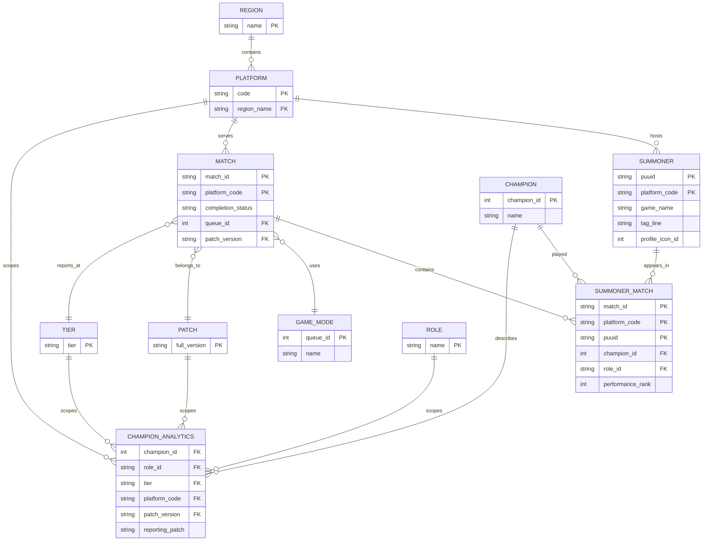
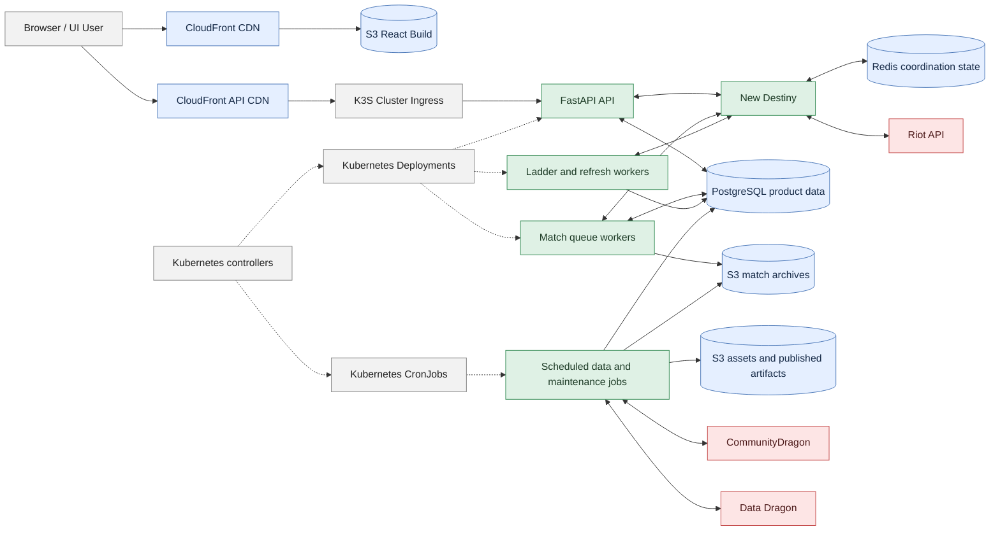
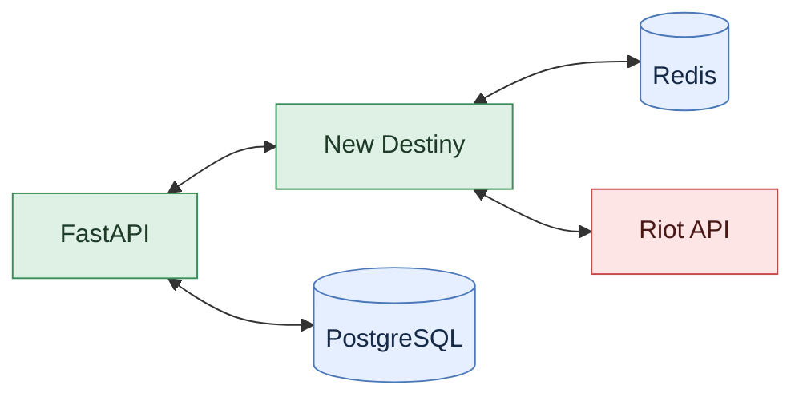
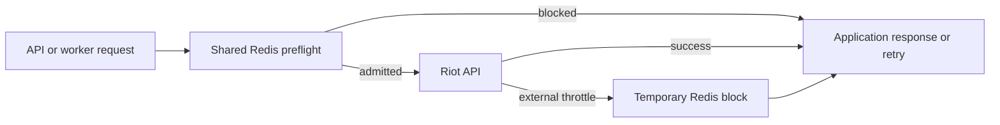
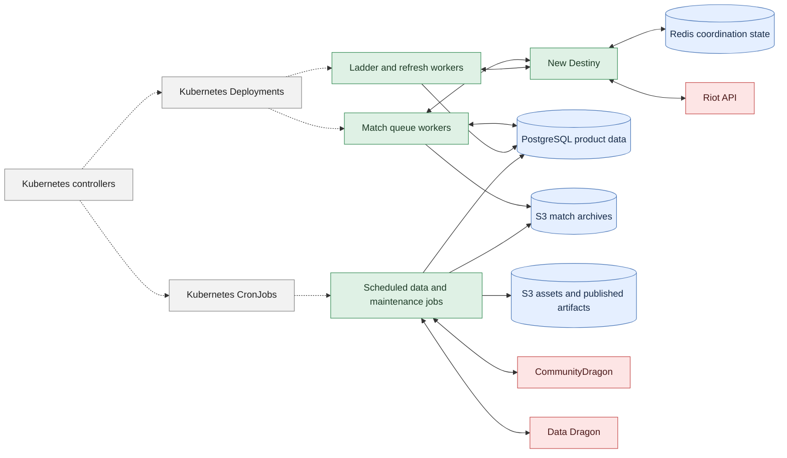

# Backend Documentation

## High Level Overview

At its core, the WINRATES.GG (WR.GG) API, or `backend`, implements a read-through cache that sits between UI application users and the various Riot Games APIs for League of Legends. WR.GG also augments Riot payloads and implements product- and domain-specific data ingestion, data cleaning, data normalization, data analysis, and data storage patterns. Beyond the core Riot APIs, WR.GG also relies on supporting Riot and third-party services such as Community Dragon, which provide critical and ever-changing foundational information. Much of this automated upkeep code uses the same data models and patterns as the API, so that logic is defined and bundled here as well.

## Primary Technology
The core API is written in the Python web framework FastAPI. FastAPI was selected when WR.GG was migrated out of Django because its async support and syntax were simpler for this workload. WR.GG relies on more than over 1 million external API calls per day to hydrate the baseline product, some of these calls happen concurrently inside the HTTP request-response cycle so the simplicity of FastAPI async path (endpoint) functions made it more attractive.

## Core Data Model

WR.GG uses a larger schema than what is shown, with over 50 entities in production, but the entity relationship diagram (ERD) below covers the most important part of WR.GG's data model. The design of your application's data model is one of the primary tasks of a third-party League of Legends developer. Some of these relationships are implied by the shape of Riot API payloads, while others are domain-specific and must be implemented by the developer.

### Domain Concepts

- `Summoner` represents a "player" or a Riot Account registered on a platform. It is identified by a Riot PUUID (Player Universally Unique Identifier) together with the platform
  code, rather than by a user-facing display name. Display names can change, are not fully unique, and accounts can be transferred between platforms, so the PUUID + platform code make up the composite primary key.
- `Platform` is what players colloquially call a server: `na1` is North America,
  `kr` is Korea, and `euw1` is Europe West, etc.
- `Region` groups related platforms;
  for example, the `americas` region spans North America, Brazil,
  Latin America North, and Latin America South.
- `Match` records individual game instances. Completion status distinguishes usable completed games from remakes, terminated games, unexpected or malformed payloads, and unknown historical records.
- `SummonerMatch` is the through table for the many-to-many relationship between Summoners and Matches. It also stores participant-specific dimensions such as champions played, role selected, and performance.
- `Champion`, `GameMode`, `Patch`, `Tier`, and `Role` are shared dimensions that help enable some of the fundamental query patterns WR.GG supports (i.e. "What is the win rate of Brand Support on this current patch in Diamond Elo?")
- The many analytics tables reuse those dimensions to store product-specific
  observations related to champion performance, itemization outcomes, matchups, synergies,
  scaling, and more. `CHAMPION_ANALYTICS` is an illustrative catch-all term for that family of derived analytics. It is not a literal table.

### Primary API Endpoints

The primary public endpoints users interact with:

| Concern | Endpoints | Description |
| --- | --- | --- |
| Player profiles | `/summoner/`, `/summoner-search/` | Resolve display names, build profiles, expose match history, and request fresh data when needed |
| Champion and player discovery | `/champion-search/`, `/champions/`, `/leaderboards/champion-players/` | Search champions and find players associated with them |
| Champion analytics | `/analytics/champion-tier-list/`, `/analytics/champion-performance/`, `/analytics/champion-item-builds/`, `/analytics/champion-runes/`, `/analytics/champion-keystones/` | Serve win rates, builds, runes, matchups, scaling, and performance analysis |
| Champion context | `/analytics/champion-metadata/`, `/analytics/champion-context/`, `/analytics/champion-evolution-paths/`, `/analytics/champion-transformations/` | Supply patch, role, evolution, transformation, and product-specific context |
| Ladders and mastery | `/ladder/`, `/leaderboards/mastery/` | Serve ranked ladder snapshots and mastery leaderboards |
| Live games | `/live-game/` | Resolve and describe an active game when one exists |

## Runtime Context

### Diagram: Runtime Topology And Boundaries
This diagram outlines the major conceptual boundaries with an emphasis on the main integration points for the backend concern: public delivery, cluster workload, Riot API access & rate limiting, data persistence, and durable artifacts. See the [cluster documentation](kubernetes-runtime.md) for detailed and more representative cluster design.

### Diagram Legend

The diagrams in this document use the shared architecture palette:

| Color | Meaning |
| --- | --- |
| Gray | User-facing actors or boundaries |
| Green | Highlighted WR.GG application code/workload runtime (AWS or on-prem; see [Infrastructure](infrastructure.md)) |
| Blue | AWS-hosted infrastructure |
| Red | External services outside WR.GG's ownership |

## Core API Functionality

The core function of the FastAPI API is to serve responses to synchronous, browser-originating HTTP requests. FastAPI validates requests, considers data freshness requirements, serves stale data when appropriate or seeks fresh data when required, coordinates shared rate-limit state through Redis, and uses rate-limit-aware Riot API requests when fresh external data is needed.

### YOU ARE HERE - Inside the Runtime Topology And Boundaries Diagram

This is the portion of the integrated backend covered by the Core API section.
FastAPI and New Destiny are the application path; PostgreSQL is the durable state
it reads and writes, Redis is the shared coordination state New Destiny uses, and
the Riot API is the external service it calls.

### Diagram: Synchronous API Flow

This sequence view is initiated by the browser or end user. Read each section
from top to bottom. `alt` means that exactly one branch occurs. Inside the outermost `alt` chart `[ALTERNATIVE: update=True]` green represents successfully fetched and built data, the yellow outcome is a local rate-limit
block with enough persisted data for a sensical partial response, and the red outcome
is a local rate-limit block without enough persisted data to respond properly.

```mermaid
%%{init: {"theme": "base", "themeVariables": {"background": "#0f172a", "primaryColor": "#172033", "primaryTextColor": "#f8fafc", "primaryBorderColor": "#94a3b8", "lineColor": "#cbd5e1", "actorBkg": "#111827", "actorBorder": "#cbd5e1", "actorTextColor": "#f8fafc", "actorLineColor": "#64748b", "signalColor": "#cbd5e1", "signalTextColor": "#f8fafc", "labelBoxBkgColor": "#1e293b", "labelBoxBorderColor": "#94a3b8", "labelTextColor": "#f8fafc", "noteBkgColor": "#334155", "noteBorderColor": "#cbd5e1", "noteTextColor": "#f8fafc"}}}%%
sequenceDiagram
    actor User as Browser / UI User
    participant API as FastAPI
    participant ND as New Destiny
    participant Redis as Redis
    participant Riot as Riot API
    participant DB as PostgreSQL
    participant Queue as match_build_queue

    Note over User,Queue: SYNCHRONOUS USER REQUEST
    rect rgb(23, 32, 51)
        alt ALTERNATIVE: update=False
            rect rgb(30, 50, 78)
                User->>API: Request existing profile
                API->>DB: Read durable state
                DB-->>API: Existing profile data
                API-->>User: Current stored response (203)
            end
        else ALTERNATIVE: update=True
            rect rgb(30, 50, 78)
                User->>API: Request refresh
                API->>ND: Outbound Riot request
                ND->>Redis: Preflight admission
                Redis-->>ND: Admit or block

                alt OUTCOME: admitted
                    rect rgb(25, 76, 52)
                        ND->>Riot: Riot API request
                        Riot-->>ND: Fresh Riot data
                        ND-->>API: Fresh result
                        API->>DB: Persist refreshed profile state
                        API->>Queue: Enqueue missing match IDs
                        API-->>User: Fresh profile response (201)
                    end
                else OUTCOME: blocked - persisted state sufficient
                    rect rgb(82, 69, 24)
                        ND-->>API: Rate-limit exception
                        API->>DB: Read existing profile state
                        DB-->>API: Stale profile data
                        API-->>User: Cached/partial response (206) + retry-after
                    end
                else OUTCOME: blocked - persisted state insufficient
                    rect rgb(92, 35, 45)
                        ND-->>API: Rate-limit exception
                        API->>DB: Read existing profile state
                        DB-->>API: No minimum viable profile
                        API-->>User: Failed dependency (424) + retry-after
                    end
                end
            end
        end
    end
```

### New Destiny And Rate Limiting

New Destiny is a separately packaged open source library and rate limiting solution for the Riot API. At the time of writing, it had over 1,500 downloads (excluding mirrors) on [PyPI](https://pypi.org/project/new-destiny/). It was created by Victor Haynes as an unopinionated, flexible, scalable, and low-maintenance solution to solve the primary pain point of third-party Riot developers. See the [New Destiny documentation](https://github.com/victorhaynes/new-destiny) for more detail. Riot publishes extensive rules on API usage, and production-minded League of Legends integrations must respect them. This was created to solve my own problem but also to provide a free solution to the buzzing, officially unofficial, third-party Riot developer community.

You drop in a properly formatted URL (a Riot API endpoint with appropriate headers and URL params) and New Destiny does the rest:

- atomically admits or rejects the request before it reaches Riot;
- scopes individual requests down to the rate limiters that apply to it;
- works with or without concurrent callers;
- models application, service, and method limits across Riot services and
  endpoints by routing value;
- respects global blocks, unplanned outages, and transient outages, and can
  parse and respect blocks with many different scopes;
- operates on a "Respect first" principle: it blocks a request that would
  trigger a known violation instead of waiting for Riot to reject it;
- can add protective fallback blocks for unexplained cases and legitimate
  leakage or out-of-sync scenarios;
- uses Riot's retry timing when it is available and records the outcome for
  operations;
- can expose low-cardinality and request-level metrics allowing user-driven analytics.

Read more of the documentation and finer details on [PyPI](https://pypi.org/project/new-destiny/).

The library models the high-level rules Riot communicates, but it cannot
observe every implementation detail of Riot's counters. A small amount of
bounded mismatch is therefore possible even with normal configuration. The
important design property is that internal and external enforcement remain
visible and that all callers share the same protective posture.

### Data Lifecycle And Persistence

The backend deliberately separates durable product data from shared runtime
coordination:

- **PostgreSQL** is the durable storage layer for structured relational data,
  including profiles, matches, normalized entities, queue rows, snapshots, and
  derived analytics.
- **S3** provides durable object storage for compressed JSON match archives,
  assets, and published static artifacts.
- **Redis** is shared coordination state and is deeply integrated with New
  Destiny, the purpose-built Riot API rate-limiting package authored for WRGG.
  

The backend generally follows this lifecycle:

1. A request or worker resolves the relevant platform, player, champion, patch,
   tier, and role context.
2. The API or worker reads the best available durable state from PostgreSQL.
3. If fresh external data is needed, New Destiny uses Redis to coordinate
   admission before the caller reaches Riot.
4. Successful external data is normalized into PostgreSQL, while match archives
   and published artifacts are written to S3.
5. Later requests read the persisted result instead of repeating the entire
   external fetch.

The resulting system is intentionally mixed: current identity and profile state
can be refreshed, completed match facts are retained, and analytics are
recomputed or published from durable facts as the relevant patch and cohort data
change.

## Background Processing

Background processing is the asynchronous portion of the backend. The core API
can record work for later completion; long-running worker Deployments claim and
process queue rows or refresh snapshots, while Kubernetes CronJobs start finite
catalog, analytics, asset, archive, SEO, and maintenance jobs.

### YOU ARE HERE - Inside the Runtime Topology And Boundaries Diagram

This is the portion of the integrated backend covered by the Background
Processing section. Kubernetes controllers reconcile Deployments and CronJobs;
Deployments keep long-running workers alive, while CronJobs start finite
scheduled jobs. Workers and scheduled jobs use New Destiny and Redis when they
need Riot data, then write durable results to PostgreSQL or S3.

### Diagram: Deployment-Managed Worker Flow

This sequence view covers the 2 main long-running workers process that are ran by Kubernetes
Deployments: match processing (the draining of the accumulated match ID queue) and the ranked ladder refreshing (the continual updating of live player ranks across the globe).
Read each path from top to bottom. `par` means the paths may run concurrently;
`alt` means exactly one outcome occurs within that path. Green identifies
successful completion, yellow identifies handled rate-limit sleep and retry scenario, and red
identifies a real processing or refresh failure.

```mermaid
%%{init: {"theme": "base", "themeVariables": {"background": "#0f172a", "primaryColor": "#172033", "primaryTextColor": "#f8fafc", "primaryBorderColor": "#94a3b8", "lineColor": "#cbd5e1", "actorBkg": "#111827", "actorBorder": "#cbd5e1", "actorTextColor": "#f8fafc", "actorLineColor": "#64748b", "signalColor": "#cbd5e1", "signalTextColor": "#f8fafc", "labelBoxBkgColor": "#1e293b", "labelBoxBorderColor": "#94a3b8", "labelTextColor": "#f8fafc", "noteBkgColor": "#334155", "noteBorderColor": "#cbd5e1", "noteTextColor": "#f8fafc"}}}%%
sequenceDiagram
    actor Controller as Kubernetes controllers
    actor Deployment as Kubernetes Deployment
    participant MatchWorker as Match worker
    participant Queue as match_build_queue
    participant LadderWorker as Ladder worker
    participant ND as New Destiny
    participant Redis as Redis
    participant Riot as Riot API
    participant DB as PostgreSQL
    participant S3 as S3 buckets

    Note over Controller,S3: DEPLOYMENT-MANAGED WORKER PROCESSING
    rect rgb(23, 32, 51)
        par MATCH QUEUE DRAIN
            rect rgb(30, 50, 78)
                Controller->>Deployment: Reconcile Deployment
                Deployment->>MatchWorker: Keep worker running
                MatchWorker->>Queue: Claim and update rows
                loop PROCESS CLAIMED QUEUE JOB
                    MatchWorker->>ND: Outbound Riot request
                    ND->>Redis: Preflight admission
                    Redis-->>ND: Admit or block
                    alt OUTCOME: admitted - request proceeds
                        rect rgb(25, 76, 52)
                            ND->>Riot: Riot API request
                            Riot-->>ND: Fresh Riot data
                            ND-->>MatchWorker: Fresh result
                            alt OUTCOME: processing completed
                                MatchWorker->>DB: Persist normalized match data
                                MatchWorker->>S3: Write match archive
                                MatchWorker->>Queue: Mark row done and release claim
                            else OUTCOME: processing error - retry or fail
                                rect rgb(92, 35, 45)
                                    MatchWorker->>Queue: Record retry or failed state
                                    MatchWorker-->>MatchWorker: Apply bounded backoff or stop after retry budget
                                end
                            end
                        end
                    else OUTCOME: rate limited - sleep and retry
                        rect rgb(82, 69, 24)
                            ND-->>MatchWorker: Rate-limit exception
                            MatchWorker->>Queue: Record retry state and retain claim
                            MatchWorker-->>MatchWorker: Sleep retry-after + 1 second
                        end
                    end
                end
            end
        and LADDER REFRESH
            rect rgb(30, 50, 78)
                Controller->>Deployment: Reconcile Deployment
                Deployment->>LadderWorker: Keep worker running
                LadderWorker->>ND: Outbound Riot request
                ND->>Redis: Preflight admission
                Redis-->>ND: Admit or block
                alt OUTCOME: refresh completed
                    rect rgb(25, 76, 52)
                        ND->>Riot: Riot API request
                        Riot-->>ND: Fresh Riot data
                        ND-->>LadderWorker: Fresh result
                        LadderWorker->>DB: Persist ladder snapshot
                    end
                else OUTCOME: rate limited - bounded sleep and retry
                    rect rgb(82, 69, 24)
                        ND-->>LadderWorker: Rate-limit exception
                        LadderWorker-->>LadderWorker: Retry wrapper sleeps and retries
                    end
                else OUTCOME: refresh error - stop snapshot attempt
                    rect rgb(92, 35, 45)
                        LadderWorker-->>LadderWorker: Do not publish a new snapshot
                    end
                end
            end
        end
    end
```

### Diagram: CronJob-Started Processing Flow

This sequence view covers recurring jobs initiated by Kubernetes CronJobs.
These are the main CronJobs. They reconcile upstream catalog data and publish durable application or asset state. League of Legends receives upstream updates multiple times a day and major patches arrive every two weeks; these jobs keep WR.GG constantly in sync.

```mermaid
%%{init: {"theme": "base", "themeVariables": {"background": "#0f172a", "primaryColor": "#172033", "primaryTextColor": "#f8fafc", "primaryBorderColor": "#94a3b8", "lineColor": "#cbd5e1", "actorBkg": "#111827", "actorBorder": "#cbd5e1", "actorTextColor": "#f8fafc", "actorLineColor": "#64748b", "signalColor": "#cbd5e1", "signalTextColor": "#f8fafc", "labelBoxBkgColor": "#1e293b", "labelBoxBorderColor": "#94a3b8", "labelTextColor": "#f8fafc", "noteBkgColor": "#334155", "noteBorderColor": "#cbd5e1", "noteTextColor": "#f8fafc"}}}%%
sequenceDiagram
    actor Controller as Kubernetes controllers
    actor Cron as Kubernetes CronJob
    participant Jobs as Scheduled jobs
    participant CDragon as CommunityDragon
    participant DDragon as Data Dragon
    participant DB as PostgreSQL
    participant S3 as S3 buckets

    Note over Controller,S3: CRONJOB-STARTED SCHEDULED PROCESSING
    rect rgb(23, 32, 51)
        rect rgb(30, 50, 78)
            Controller->>Cron: Reconcile CronJob schedule
            Cron->>Jobs: Start scheduled processing
            alt OUTCOME: scheduled processing completed
                rect rgb(25, 76, 52)
                    Jobs->>CDragon: Read upstream catalog data
                    CDragon-->>Jobs: Catalog response
                    Jobs->>DDragon: Read upstream catalog data
                    DDragon-->>Jobs: Catalog response
                    Jobs->>DB: Write normalized data
                    Jobs->>S3: Write assets or published artifacts
                end
            else OUTCOME: scheduled processing failed
                rect rgb(92, 35, 45)
                    Jobs-->>Jobs: Job exits with failure
                end
            end
        end
    end
```

The match queue is the handoff between synchronous user-request-driven discovery
and asynchronous background match processing. Separately, the main CronJobs start
scheduled work; catalog and asset jobs consume CommunityDragon and Data Dragon
inputs and write normalized results to PostgreSQL or S3.

### Worker System

The API and worker images are two Docker targets built from the same backend
repository, Dockerfile, and build context. The Dockerfile's shared `base`
stage gives them the same Python runtime, operating-system packages,
`requirements.txt` dependencies, and common modules. However they are not identical
images:

- The `api` target adds `main.py`, FastAPI routes, Alembic migrations, and the
  API-only files needed to serve HTTP requests.
- The `worker` target adds worker modules, asset-refresh scripts, and the small
  API utility surface those workers import.

The release workflow builds both targets from the same source release and
publishes them to separate ECR repositories. Kubernetes then selects the API
image for the FastAPI deployment and the worker image for match, ladder,
maintenance, and scheduled data jobs. The `dashboard-api` deployment is a
dashboard-only FastAPI process based on the API image; the dashboard's static
React files are served by a separate, small web image.

This keeps source and dependency versions aligned without pretending that API
availability and background throughput are the same workload.

#### Match Queue Worker

The match worker claims queued match ID/platform pairs, performs rate-limit-aware
outbound Riot requests, writes match archives to S3, persists normalized match and
player data to PostgreSQL, and records terminal or retryable outcomes. This is the
path that turns user-initiated or system-generated queue entries into durable match
history JSON and UI-served data.

Claims are platform-scoped and selected in descending `match_id` order. Concurrent
workers use row locking, so a locked row may be skipped; this is ordered work, but
not strict FIFO.

When New Destiny raises a rate-limit exception during match processing, the worker does not release
the queue row. It records the rate-limit error, changes the row to `retry`,
retains the current claim, sleeps for `retry_after + 1` seconds, and retries the
same queue job. A successful completion changes the row to `done` and releases
the claim. If the worker dies, stale-lease reclamation eventually returns the
row to `queued` so another worker can claim it.

#### Ladder Worker

The ladder worker refreshes ranked snapshots for all (supported) regions. It fetches
the relevant ranked pages, resolves the player and mastery data needed for the
ladder view, updates durable records, and publishes the snapshot consumed by
the API. Past versions were browser-initiated single page at a time, but this being continually generated, stored, and served on-demand was clearly the superior pattern. The New Destiny retry wrapper sleeps and retries rate-limited requests within its retry budget. If that budget is exhausted, the current all-or-none snapshot attempt stops without publishing a new snapshot.

#### Scheduled Data And Asset Jobs

Recurring jobs keep the rapidly changing game catalog usable:

- patch partitions and reference data;
- champions, items, runes, spells, game modes, and icons;
- CommunityDragon-backed asset reconciliation;
- tier-cohort and other derived analytics refreshes.

Initialization and recurring reconciliation use different patch-readiness
policies so a fresh environment can start before every upstream source is ready.

#### Archive, SEO, And Maintenance Jobs

Archive reconciliation repairs database references against retained S3 match
objects. Archive cleanup removes expired objects according to the retention
policy. The SEO publisher reads the database-backed report manifest, renders
static pages and sitemap content, and publishes them to the public site bucket.

These jobs produce or maintain derived and operational state; they do not
replace PostgreSQL as the durable application source of truth.

## Database Lifecycle

Database schema changes are versioned with Alembic. Runtime startup does not
silently create schema changes; the initialization sequence applies migrations from
the checked-in migration files included in the backend release and then runs
idempotent seed and refresh jobs. Existing data is treated as durable state, so destructive reset and snapshot restore are explicit infrastructure
operations rather than normal application deployment behavior.

## Failure Boundaries

- A backend image failure affects the API & worker deployments and the cronjobs using that release, but an earlier immutable artifact can be selected without rebuilding.
- A worker failure delays ingestion and derived data, but does not make the
  public static shell unavailable. When catalog data is missing, placeholders can
  be inserted and then reconcilers use an UPSERT pattern.
- Redis loss affects coordination, rate limiting, and dashboard
  observations/request-related metrics. It is not a durable-data outage, but Riot
  is more likely to rate limit you while New Destiny rebuilds its local state from
  subsequent requests; it is written to recover from this kind of state loss.
- PostgreSQL failure affects durable product behavior and requires the explicit
  storage recovery path described in [Infrastructure](infrastructure.md).

## Source Of Truth

This backend repository is the source of truth for runtime behavior. The
published backend release is the source of truth for a deployable image. The
production `k8s-live` revision is the source of truth for which release is
requested.
