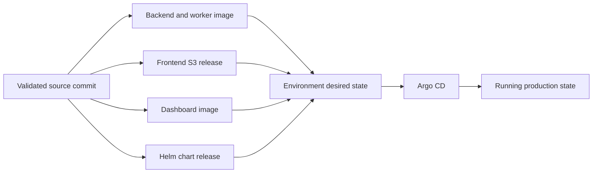

# CI/CD And Release

## Purpose

CI/CD turns validated source into immutable artifacts and promotes those
artifacts through desired state. It does not create the AWS foundation or
directly manage running Kubernetes resources.

## Release Lifecycle

The system keeps four identities separate:

- **Source history:** the code that was written and validated.
- **Artifact history:** the backend, frontend, dashboard, or chart that was
  built and published.
- **Desired state:** the exact releases an environment is requested to run.
- **Observed state:** what Argo, Kubernetes, AWS, and the private dashboard
  report about the running system.

Building an artifact does not deploy it. Selecting an artifact in desired state
does not rebuild it. Argo reconciles the selected state.

## Repository Responsibilities

| Concern | Responsibility |
| --- | --- |
| Backend repository | API and worker code, tests, backend image releases |
| Frontend repository | React site, dashboard bundle, static publication |
| Helm chart repository | Runtime templates and chart releases |
| GitOps repository | Environment artifact pointers and desired state |
| Terraform repositories | AWS infrastructure and remote state |
| Ansible repository | On-prem host preparation and attachment |

The exact repository names, workflow commands, account identifiers, and
environment hostnames remain private. The public boundary is the important
part: application repositories publish artifacts, the GitOps repository selects
them, and Argo reconciles the selection.

## Normal Promotion

1. Validate the changed source repositories.
2. Publish immutable backend, frontend, dashboard, and chart artifacts as
   applicable.
3. Review and apply infrastructure changes separately when the Terraform plan
   requires them.
4. Update the environment's Kubernetes desired state with exact artifact tags.
5. Allow Argo to reconcile the selected releases.
6. Verify API health, static delivery, data access, queue processing, and
   relevant operational metrics.

Production is the reference promotion target. Staging follows the same release
shape with isolated credentials and data so it can validate the real path
without becoming a separate architecture.

## Rollback And Recovery

Application rollback selects an earlier immutable image, frontend release, or
Helm chart and lets the normal reconciliation path apply it. It does not
rebuild the artifact, replace the control plane, or destroy the database.

Control-plane recovery, worker reattachment, database volume adoption, and
snapshot restore are separate infrastructure operations. A destructive database
reset is explicitly guarded and is never a normal application rollback.

## Design Decisions

- GitOps selects artifacts; it does not build them.
- Static delivery is separated from Kubernetes so public traffic does not
  compete with API and worker workloads.
- PostgreSQL storage has a lifecycle separate from application deployment.
- Redis coordinates runtime behavior but is not the durable product database.
- Production and staging use the same architecture with isolated environment
  state.
- The platform favors immutable releases, explicit recovery, low operating
  cost, and visible failure boundaries over automatic multi-zone failover.
