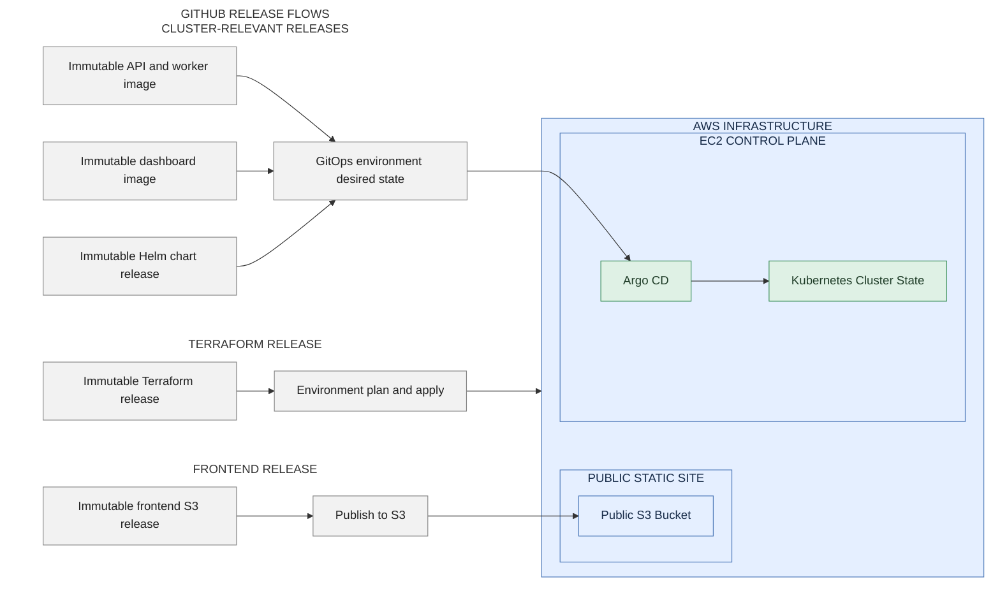
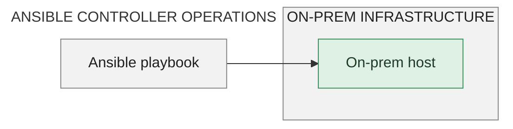

# CI/CD And Release

## High Level Overview

WR.GG's CI/CD process turns validated source code into immutable releases and
delivers each concern through its appropriate promotion path: Terraform applies
AWS infrastructure, the frontend is published directly to S3 (object storage), and the backend,
dashboard, and Helm releases are integrated with the Kubernetes cluster by uploading them to ECR (image repository) and mutating Argo CD's desired state pointers.

## Primary Technology

GitHub Actions is the CI/CD execution system. GitHub-hosted runners provide a
fresh, ephemeral machine for each workflow job; they build, validate, test source,
publish frontend and container artifacts, run approved Terraform operations,
and update the GitOps desired cluster state repository. AWS access is granted
through short-lived GitHub OIDC credentials and environment-specific IAM
roles, rather than through credentials stored on a persistent runner.

Argo CD is the automated reconciliation & continuous deploment mechanism component for the live Kubernetes cluster.

### Diagram Legend

| Color | Boundary |
| --- | --- |
| Gray | Source, release, and desired-state identity |
| Green | Validation and active runtime |
| Blue | Published artifacts and AWS delivery |

## Release Model

The system keeps four identities separate:

- **Source history:** the code that was written, validated, and tested.
- **Artifact history:** the backend, frontend, dashboard, or chart that was
  built and published.
- **Desired state:** the exact releases an environment is requested to run.
- **Observed state:** what Argo, Kubernetes, AWS, and the private dashboard
  report about the running system.

Building an artifact does not necessarily deploy it. For example new `backend` API images can be uploaded to ECR without mutating a currently running cluster.

## Continuous Integration

CI is primarily responsible for validating source code in the various repositories that own a
concern. At operator-specified times, CI publishes an immutable release, marking code
deployable.

```mermaid
flowchart TB
    subgraph BackendRepo["Backend repository"]
        BackendCommit["Validated backend source commit"] --> BackendChecks["Repository validation"]
        BackendChecks --> BackendArtifact["Immutable API and worker image"]
    end

    subgraph FrontendRepo["Frontend repository"]
        FrontendCommit["Validated frontend source commit"] --> FrontendChecks["Repository validation"]
        FrontendChecks --> FrontendArtifact["Immutable frontend S3 release"]
        DashboardCommit["Validated dashboard source commit"] --> DashboardChecks["Repository validation"]
        DashboardChecks --> DashboardArtifact["Immutable dashboard image"]
    end

    subgraph HelmRepo["Helm chart repository"]
        ChartCommit["Validated Helm source commit"] --> ChartChecks["Chart validation and render"]
        ChartChecks --> ChartArtifact["Immutable Helm chart release"]
    end

    subgraph TerraformRepo["Terraform repositories"]
        TerraformCommit["Validated Terraform source commit"] --> TerraformChecks["Format, validation, and plan"]
        TerraformChecks --> TerraformArtifact["Immutable Terraform release"]
    end

    classDef source fill:#f2f2f2,stroke:#858585,color:#202020
    classDef checks fill:#dff1e5,stroke:#3b8f5a,color:#1d3b26
    classDef artifact fill:#e5efff,stroke:#4c78b8,color:#162a47

    class BackendCommit,FrontendCommit,DashboardCommit,ChartCommit,TerraformCommit source
    class BackendChecks,FrontendChecks,DashboardChecks,ChartChecks,TerraformChecks checks
    class BackendArtifact,FrontendArtifact,DashboardArtifact,ChartArtifact,TerraformArtifact artifact
```

## Continuous Delivery

CD selects immutable releases and delivers them through the mechanism owned by
that concern. This is an explict operator action rather than a fully automated or "touchless" delivery system.

Terraform applies AWS infrastructure directly. The frontend release is
published to S3; the existing CloudFront
distribution serves that bucket as the public edge (rather than from the Kubernetes cluster). Backend, dashboard, and Helm releases are selected together in the GitOps desired cluster state repository; Argo renders the pinned chart and reconciles the resulting
Kubernetes resources on the EC2 control plane. Ansible prepares and
attaches the on-prem host outside the immutable application release path.

## Repository Responsibilities

| Concern | Responsibility |
| --- | --- |
| Backend repository | API and worker code, tests, backend image releases |
| Frontend repository | React site, dashboard bundle, static publication |
| Helm chart repository | Runtime templates and chart releases |
| GitOps desired cluster state repository | Environment artifact pointers and desired state |
| Terraform repositories | AWS infrastructure and remote state |
| Ansible repository | On-prem host preparation and attachment |

The exact repository names, workflow commands, account identifiers, and
environment hostnames remain private. The public boundary is the important
part: application repositories publish artifacts, the GitOps desired cluster state repository selects
them, and Argo reconciles the selection.

## Normal Promotion

1. Validate the changed source repositories.
2. Publish immutable backend, frontend, dashboard, and chart artifacts as
   applicable.
3. Review and apply infrastructure changes separately when the Terraform plan
   requires them.
4. Update the environment's Kubernetes desired state with exact artifact tags.
5. Allow Argo to reconcile the selected releases.
6. Verify API health, static delivery, data access, queue processing, and
   relevant operational metrics.

Production is the reference promotion target. Staging intentionally follows the same release
shape, only differing by credentials and environment specific overlays.

## Rollback And Recovery

Application rollback selects an earlier immutable image, frontend release, or
Helm chart and lets the normal reconciliation path apply it. It does not
rebuild the artifact, replace the control plane, or destroy the database.

Control-plane recovery, worker reattachment, database volume adoption, and
snapshot restore are separate infrastructure operations. A destructive database
reset is explicitly guarded and is never a normal application rollback.

## Design Decisions

- GitOps selects artifacts; it does not build them.
- Static delivery is separated from Kubernetes so public traffic does not
  compete with API and worker workloads.
- PostgreSQL storage has a lifecycle separate from application deployment.
- Production and staging use the same architectures, the same repositories and the same branches (no-drift), with isolated environment
  state.
- The solution  favors immutable releases to easily identify state and make rollbacks simple
