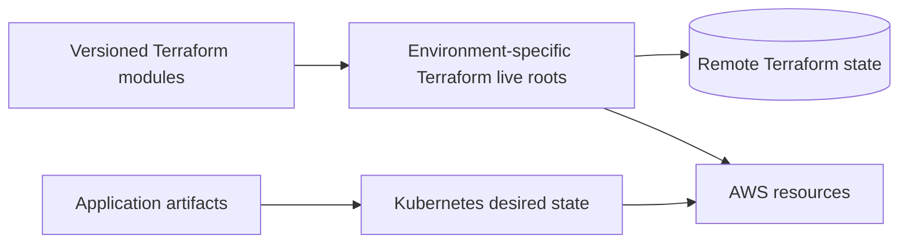

# Cloud Infrastructure

## Purpose

Terraform composes the AWS resources required by the production platform. It
does not build application artifacts and it does not decide which backend or
frontend release is running. Those are separate release and GitOps concerns.

## Module And Live Boundaries

The reusable module repository owns resource primitives and publishes module
versions. The live repository composes those modules for management,
staging, and production roots and owns the corresponding remote state. The
application and cluster repositories consume the resulting resource contract;
they do not reimplement it.

## Production Resource Concerns

- account and IAM boundaries for deployment and runtime access;
- VPC, subnets, security groups, and the control-plane host;
- EBS database storage and snapshot lifecycle;
- S3 buckets for public content, archives, and release artifacts;
- CloudFront distributions and flat-rate delivery plans;
- certificates, hosted-zone records, and environment DNS;
- ECR repositories for backend and dashboard images;
- CloudWatch metrics, alarms, and operational notifications.

The exact account IDs, names, addresses, and state locations are intentionally
omitted from this public repository.

## Storage And Destructive Operations

Database storage is modeled separately from the application runtime. A normal
Terraform apply may adopt an existing volume or use an explicitly selected
restore source, while destructive volume and snapshot deletion is a separate,
manual workflow. This prevents an ordinary cluster or application change from
silently changing durable database state.

## Domain And Delivery Boundary

The domain was established before account segregation, so foundational domain
ownership and environment application resources are treated as separate
concerns. The important design property is explicit cross-account wiring for
certificates, hosted zones, and records, rather than pretending that all DNS
resources belong to the same account.

## Terraform Source Of Truth

Terraform state answers what the declared infrastructure currently owns. The
live root and its selected module version answer how that infrastructure is
composed. A plan is the review surface; an apply changes the owned resources.
Terraform does not know whether an application release is healthy, and Argo
does not replace Terraform as the owner of AWS infrastructure.
