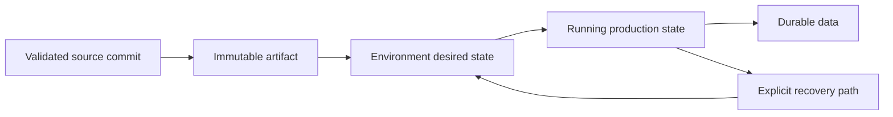

# Concern Guide

## Purpose

This is the index for the production architecture case study. WINRATES.GG is
implemented across several private repositories, but the public explanation is
organized by the engineering questions a reader actually has:

- How does a user reach the product?
- How does the application acquire and process data?
- Where does durable state live?
- How does infrastructure become a running cluster?
- How are releases promoted and recovered?

The same component may appear in more than one concern because ownership and
runtime behavior are different questions. The pages link back to the same
canonical diagrams instead of redrawing the whole system each time.

## Ownership Map

| Concern | Primary implementation | Public explanation |
| --- | --- | --- |
| Product runtime | `backend` | [Backend runtime](backend-runtime.md) |
| Public web delivery | `frontend` | [Frontend delivery](frontend-delivery.md) |
| Durable and derived data | `backend`, runtime jobs, S3 | [Data and analytics](data-and-analytics.md) |
| AWS resources | Terraform module and live repositories | [Cloud infrastructure](cloud-infrastructure.md) |
| On-prem host lifecycle | `infra-ansible-on-prem` | [Host and cluster foundation](host-and-cluster.md) |
| Kubernetes templates | `k8s-helm-charts` | [Kubernetes delivery](kubernetes-delivery.md) |
| Environment desired state | `k8s-live` and Argo CD | [Kubernetes delivery](kubernetes-delivery.md) |
| Release and recovery policy | Workflows and operator runbooks | [Delivery and operations](delivery-and-operations.md) |

## Source Of Truth By Question

| Question | Source of truth |
| --- | --- |
| What code exists? | The application repository at a validated commit |
| What artifact was built? | The immutable backend, frontend, dashboard, or chart release |
| What should production run? | The production desired-state revision in `k8s-live` |
| What is actually running? | Argo, Kubernetes, AWS, and the private dashboard |
| What data should survive application replacement? | PostgreSQL and retained S3 objects |
| What is coordination state? | Redis, with deliberately temporary semantics |
| How is the on-prem host attached? | Ansible's environment attachment state |

## Lifecycle View

The most important boundary is between an artifact and desired state. Building
an artifact does not deploy it. Selecting a tag in desired state does not
rebuild it. Argo reconciles the selected state, while data storage follows its
own lifecycle.

## Documentation Rules

Each concern page uses the same compact structure:

1. Purpose and boundaries.
2. Major components and ownership.
3. Lifecycle or request flow.
4. Source of truth.
5. Failure boundary and recovery posture.

This keeps the documentation useful to a portfolio reader without turning it
into a copy of the private codebase or an operator-only runbook.
