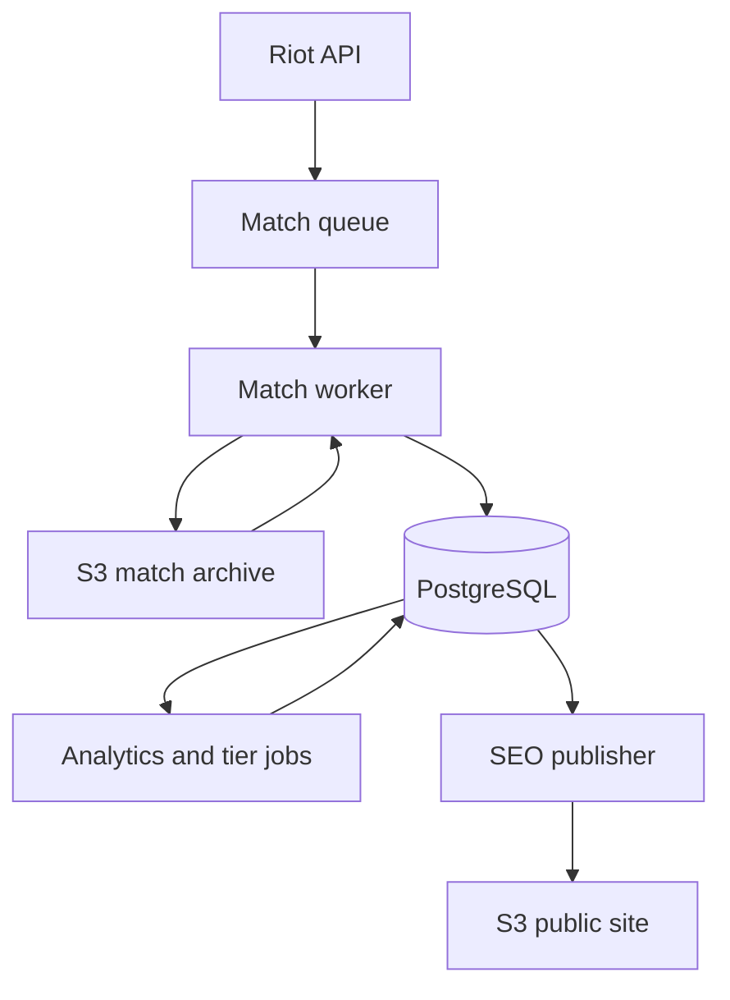

# Data And Analytics

## Purpose

WINRATES.GG combines several data lifecycles. Durable product facts, temporary
coordination state, external archives, and derived analytics have different
owners and retention rules. Keeping them separate makes recovery and rebuilds
more predictable.

## Storage Roles

| Store | Role | Lifecycle |
| --- | --- | --- |
| PostgreSQL | Summoners, matches, analytics, queue records, and catalog state | Durable application source of truth |
| Redis | Rate-limit admission, temporary blocks, queue coordination, and metrics | Shared runtime state with expiration or rebuild semantics |
| S3 match archives | Raw or normalized match payloads used for processing and repair | Retained according to archive policy |
| S3 public site | Frontend releases, static assets, SEO pages, sitemap, and public metadata | Versioned publication surface |

## Ingestion And Derivation

The queue is the admission and work-tracking point, not the durable source of
truth for match analytics. A worker can retry external requests and reconcile
archive state without making the browser responsible for ingestion. Match
completion status is persisted at the database level so incomplete or
malformed games can be excluded from performance calculations consistently
across API and frontend queries.

## Derived Data

Analytics jobs read durable match and catalog data, apply product thresholds,
and write derived facts that the API can serve efficiently. The tier cohort
job, asset refresh jobs, archive reconciliation, and SEO publisher are all
scheduled workloads. Their schedules are Kubernetes configuration; their
processing logic belongs to the backend worker artifact.

## Rebuild And Recovery Posture

- PostgreSQL is retained across normal application replacement.
- S3 archives provide a repair input when the database contains a recoverable
  match reference.
- Derived analytics can be regenerated from durable inputs when the relevant
  job and source data are available.
- Redis metrics and temporary blocks are intentionally not treated as a
  historical audit log.
- A database snapshot restore is a deliberate change to durable state and is
  separate from a normal GitOps rollout.

## Important Boundary

The system does not promise that every derived view is instantly complete. It
does promise that the source and processing boundaries are explicit: external
data enters through protected workers, durable facts live in PostgreSQL, and
derived views are produced by repeatable jobs.
