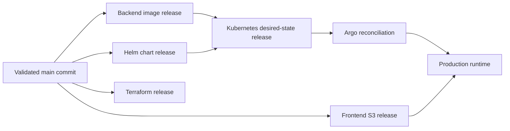
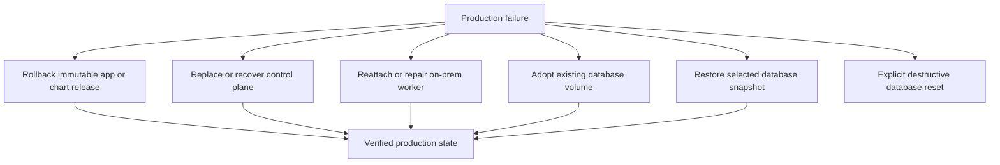

# Delivery And Operations

This page is the cross-cutting lifecycle view. The implementation concerns are
described separately in [Cloud infrastructure](cloud-infrastructure.md),
[Host and cluster foundation](host-and-cluster.md), [Kubernetes delivery](kubernetes-delivery.md),
[Backend runtime](backend-runtime.md), and [Frontend delivery](frontend-delivery.md).

## Release Model

The system uses immutable release identities across its repositories.

A normal merge validates code. A deliberate publish operation creates an
immutable artifact tag. A separate desired-state operation selects the
artifacts that production should run. Argo then reconciles that selection.

This creates a useful distinction:

- **Source history:** what code was written.
- **Artifact history:** what was built and published.
- **Desired state:** what production is intended to run.
- **Observed state:** what Argo, Kubernetes, AWS, and Terraform report.

## Ownership Boundaries

| Concern | Primary owner | Responsibility |
| --- | --- | --- |
| Application code | Backend and frontend repositories | Code, tests, and artifact builds |
| Terraform modules | Module repository | Reusable infrastructure primitives |
| Live infrastructure | Terraform live repository | AWS resources and state |
| Kubernetes templates | Helm chart repository | Runtime manifests and sync ordering |
| Kubernetes selection | GitOps repository | Environment artifact pointers |
| On-prem host | Ansible repository | Host preparation, SSM, network, and K3s attachment |
| Operations | Runbooks and workflow controls | Human sequence, recovery, and safety checks |

## Normal Production Promotion

1. Validate changed repositories.
2. Publish immutable backend, frontend, and chart artifacts.
3. Validate the selected Terraform source and apply infrastructure only when
   the reviewed plan is accepted.
4. Update production Kubernetes desired state with exact artifact tags.
5. Allow Argo to reconcile the cluster.
6. Verify application health, data access, queue processing, static delivery,
   and relevant operational metrics.

The exact workflow commands are intentionally kept private. This public
document describes the control model without exposing environment-specific
paths, credentials, hostnames, or destructive commands.

## Recovery Model

These paths are intentionally separate. A normal application rollback should
not mutate database storage. A database restore should be explicit because it
changes durable state. A destructive reset is a separately guarded operation,
not an accidental side effect of normal infrastructure teardown.

## Observability

The system exposes operational evidence at several levels:

- Kubernetes and Argo health for deployment state;
- CloudWatch host metrics and alarms for AWS and on-prem infrastructure;
- Redis-backed New Destiny metrics for admitted requests and rate-limit events;
- queue status and recent queue errors in the private dashboard;
- PostgreSQL records for durable application and analytics state;
- S3 and CloudFront behavior for static and archive delivery.

The private dashboard is an operational view, not a second source of truth. It
reads the existing Redis and PostgreSQL state and presents the questions an
operator needs to answer quickly.

## Staging As A Reproduction Environment

Staging is intentionally not represented as a second architecture. It uses the
same production shape and deployment path, with controlled differences:

| Dimension | Production | Staging |
| --- | --- | --- |
| Account | Isolated production account | Isolated staging account |
| Data | Durable beta data | Disposable validation data |
| Domain | Production hostnames | Staging hostnames |
| Credentials | Production Riot and AWS roles | Staging/test credentials |
| Runtime shape | Production beta scale | Lower or stress-test scale |
| Destruction | Avoid unless deliberate | Rebuildable by design |

The important engineering property is that staging validates the production
path without becoming a separate platform design.
