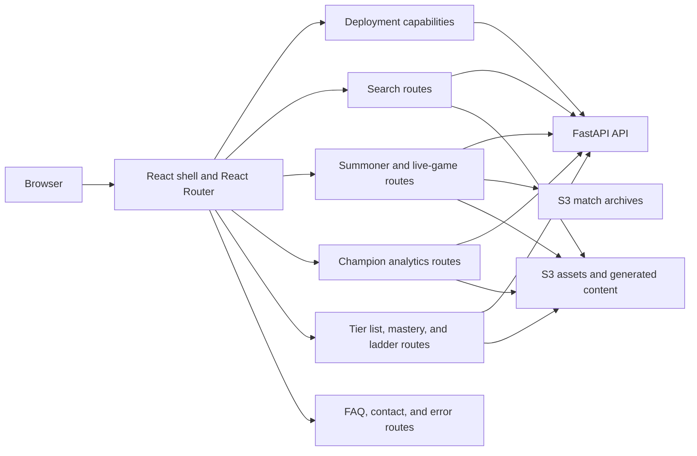
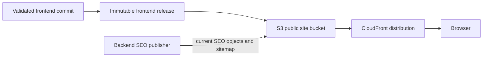
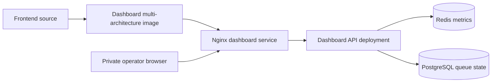

# Frontend Delivery

## Purpose

The frontend has two deliberately different delivery products:

1. The public React application, served as static content through S3 and
   CloudFront.
2. The private operations dashboard, built from the same frontend source but
   packaged as a small Nginx image and served inside the cluster.

This prevents a private operational view from becoming part of the public
website delivery contract.

## Frontend Runtime

The public product is a client-rendered React single-page application. The
browser receives the static application shell, React mounts the application,
and React Router selects the page component for the current URL. The backend
remains the source of truth for product data; the frontend assembles that data
into interactive profiles, analytics, ladders, match history, and live-game
views.

### Route And API Surface

The frontend is organized around product route families rather than one
component per API endpoint. Each route family owns its presentation and request
lifecycle while the FastAPI API owns validation, freshness, and durable data.

| Route family | Primary routes | Primary API or content boundary |
| --- | --- | --- |
| Application and search | `/`, `/search/:displayRegion` | `/capabilities/`, `/summoner-search/`, `/champion-search/`, `/leaderboards/champion-players/` |
| Summoner profiles | `/summoners/:displayRegion/:displayNameZipped`, `/live` | `/summoner/`, `/live-game/`, S3 match archives |
| Champion analytics | `/analytics/champions`, `/analytics/champions/:championNameId/:roleId` | `/analytics/patch-options/`, `/analytics/champion-metadata/`, `/analytics/champion-role-distribution/`, `/analytics/champion-performance/`, `/analytics/champion-global-trends/`, `/analytics/champion-item-builds/`, `/analytics/champion-evolution-paths/`, `/analytics/champion-runes/`, `/analytics/champion-context/`, `/analytics/champion-transformations/`, `/analytics/champion-keystones/`, `/analytics/champion-jungle-item-completion/`, and `/analytics/champion-support-item-completion/` |
| Tier lists | `/analytics/tier-list`, `/analytics/tier-list/high-mastery` | `/analytics/patch-options/`, `/analytics/champion-tier-list/` |
| Mastery | `/analytics/mastery`, `/analytics/mastery/:championNameId` | `/champions/`, `/leaderboards/mastery/` |
| Ranked ladders | `/ladder/:displayRegion/:ladderType/:pageNumber` | `/ladder/`, static map content |
| Informational and fallback pages | `/faq`, `/contact`, unmatched routes | Static React content, EmailJS contact submission, and route-level error presentation |

The analytics route family intentionally fans out to several specialized API
requests because the page presents distinct product concerns: performance,
itemization, runes, matchups, synergies, transformations, and scaling. The
frontend coordinates those requests; it does not reproduce the analytics
calculation logic.

### Application Shell And Routes

`App` owns the public shell: the header, footer, search flow, recent-search
behavior, shared platform selection, and route table. Route components own the
page-level concerns for profiles, analytics, ladders, mastery, search, live
games, and static informational pages. Legacy URLs redirect to the current
canonical routes rather than duplicating page implementations.

The URL is part of the application state. Path parameters identify resources
such as a summoner or champion, while query parameters represent views and
filters such as role, tier, patch, platform, and mastery bucket. This makes
important views linkable, reloadable, and usable as SEO targets without
requiring a server-side session.

### Data And State Boundaries

Page components use local React state and effects for loading, filtering,
selection, and request lifecycle. There is no separate global state framework;
the small amount of cross-page state is handled by the application shell,
`DeploymentCapabilitiesContext`, URL state, and selected browser `localStorage`
preferences.

The frontend uses separate clients for dynamic API data and static content:

- `axiosForAPI` resolves the environment's FastAPI origin;
- `axiosForContent` and `assetUrl` resolve static assets and generated content
  through the web origin; and
- request effects use cancellation and stale-result checks where a changing
  route, search query, or filter could make an earlier response irrelevant.

Search suggestions are debounced and cached in memory for the active page. The
selected platform and recent searches are lightweight browser preferences, not
application records.

### Deployment-Aware UI

The public application loads `/capabilities/` before rendering its route table.
That response tells the frontend which platforms the deployment supports. The
same React surface can therefore represent a narrower beta scope without
hard-coding a different product or allowing unsupported platform requests to
look available.

This is a capability boundary, not a second frontend architecture. The API
still validates requests, and the frontend uses the capability response to
shape selectors, defaults, and navigation affordances.

### Responsive And Shared Composition

The application uses shared domain data and formatting helpers while allowing
desktop and mobile compositions where the information density or interaction
model differs. Match history, analytics, ladders, icons, and profile sections
reuse shared primitives rather than each page inventing its own data format.

Loading, empty, rate-limit, dependency, and not-found states are rendered by
the relevant page or error component. This keeps Riot/API failure semantics
visible to the user instead of treating every incomplete response as a generic
frontend error.

### Build Targets

The frontend source produces two intentional targets. The normal build mounts
the public React application with browser routing and deployment-capability
initialization. The dashboard build selects `DashboardApp` instead, emits the
dashboard bundle under `/dashboard`, and is packaged separately for private
Nginx delivery. The dashboard does not become a public route merely because it
shares source components with the public application.

## Public Site Flow

The publisher writes an immutable release and then promotes the selected
content under the site's `current/` path. Hashed JavaScript and CSS assets are
cacheable. The current HTML shell and release metadata are controlled more
carefully so a new publication can be discovered without rebuilding the
backend or reading the live database from the browser.

## SEO Content

The backend periodically produces a versioned SEO content artifact from the
environment's current data. A worker publishes static HTML pages and sitemap
objects to the public site bucket. The frontend publisher does not require a
live API or database and does not delete SEO objects when the React bundle is
replaced.

This is a static publishing pattern rather than server-side rendering. The
React application remains the normal interactive experience, while generated
HTML gives crawlers meaningful page content, canonical URLs, headings, and
metadata without coupling every frontend deployment to database availability.

## Private Dashboard Flow

The dashboard image contains only the static dashboard bundle. It is selected
through Kubernetes desired state and served by private ingress. The browser
never contacts the S3 public site bucket for dashboard data. A separate
dashboard API runs the backend in a dashboard-only mode and reads existing
Redis and PostgreSQL state.

## Cache And Release Behavior

- Immutable release assets use content hashes and can remain cached.
- The current shell points at the promoted asset set.
- A browser tab may continue using an older already-loaded bundle until a new
  navigation or reload obtains the current shell.
- A CDN cache issue is therefore different from an unsuccessful publication;
  release metadata and origin responses are the first checks.

## Ownership

The frontend repository owns React components, public assets, maintenance
content, dashboard packaging, and frontend publication workflows. S3 and
CloudFront own static serving. The backend owns generated SEO content. Argo
selects the dashboard image but does not deploy the public React bundle.
