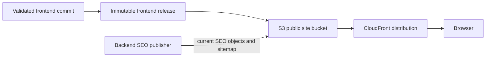
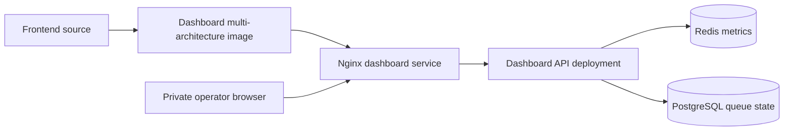

# Frontend Delivery

## Purpose

The frontend has two deliberately different delivery products:

1. The public React application, served as static content through S3 and
   CloudFront.
2. The private operations dashboard, built from the same frontend source but
   packaged as a small Nginx image and served inside the cluster.

This prevents a private operational view from becoming part of the public
website delivery contract.

## Public Site Flow

The publisher writes an immutable release and then promotes the selected
content under the site's `current/` path. Hashed JavaScript and CSS assets are
cacheable. The current HTML shell and release metadata are controlled more
carefully so a new publication can be discovered without rebuilding the
backend or reading the live database from the browser.

## SEO Content

The backend periodically produces a versioned SEO content artifact from the
environment's current data. A worker publishes static HTML pages and sitemap
objects to the public site bucket. The frontend publisher does not require a
live API or database and does not delete SEO objects when the React bundle is
replaced.

This is a static publishing pattern rather than server-side rendering. The
React application remains the normal interactive experience, while generated
HTML gives crawlers meaningful page content, canonical URLs, headings, and
metadata without coupling every frontend deployment to database availability.

## Private Dashboard Flow

The dashboard image contains only the static dashboard bundle. It is selected
through Kubernetes desired state and served by private ingress. The browser
never contacts the S3 public site bucket for dashboard data. A separate
dashboard API runs the backend in a dashboard-only mode and reads existing
Redis and PostgreSQL state.

## Cache And Release Behavior

- Immutable release assets use content hashes and can remain cached.
- The current shell points at the promoted asset set.
- A browser tab may continue using an older already-loaded bundle until a new
  navigation or reload obtains the current shell.
- A CDN cache issue is therefore different from an unsuccessful publication;
  release metadata and origin responses are the first checks.

## Ownership

The frontend repository owns React components, public assets, maintenance
content, dashboard packaging, and frontend publication workflows. S3 and
CloudFront own static serving. The backend owns generated SEO content. Argo
selects the dashboard image but does not deploy the public React bundle.
