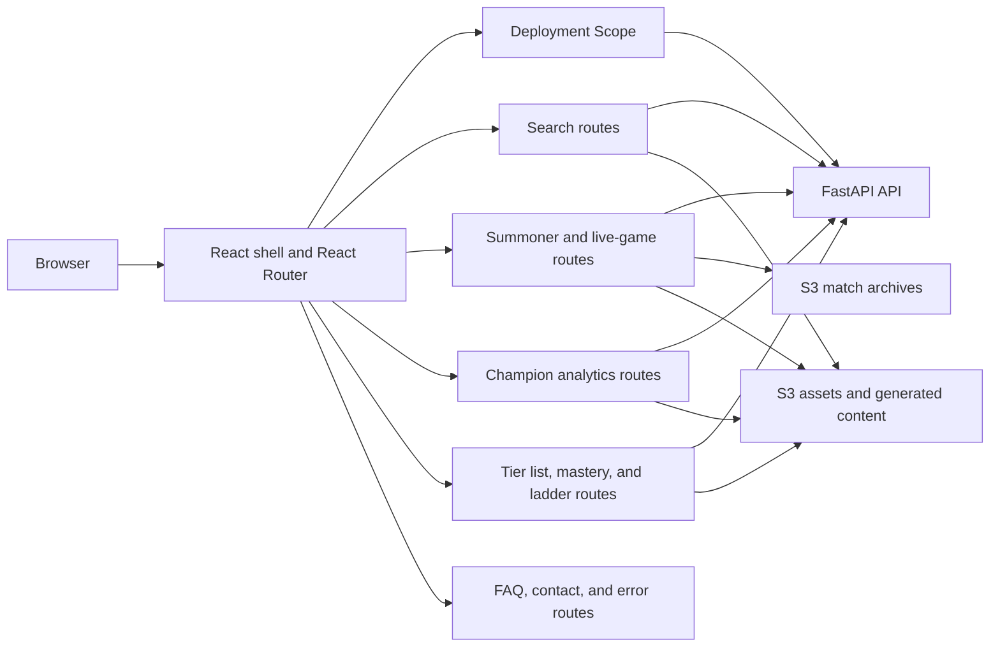
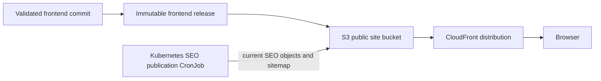
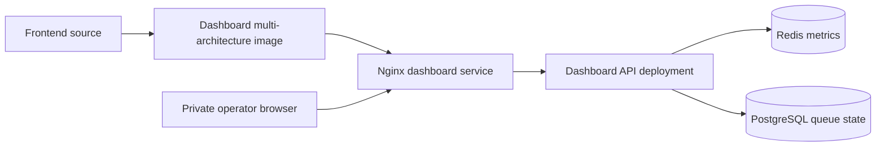

# Frontend Delivery

## Purpose

The `frontend` spans two primary delivery products:

1. The public React build, served as static content through S3 and
   CloudFront.
2. A private operations dashboard, built from the same frontend source but
   packaged as a small Nginx image and served inside the cluster accessible only through a private network.

This prevents private operational applications from becoming part of the public
website delivery surface.

## Frontend Architecture

The WR.GG UI is a client-rendered React single-page application. The
browser receives the static app shell, React mounts the application,
and React Router selects the page component for the current URL. While the backend
and multiple S3 buckets are the source of truth for product data. The frontend fetches that data
and assembles it into meaning features: interactive player profiles, analytics, ladders, match history, and live-game views.

### Route And API Surface

The frontend is organized around product route families rather than one
component per API endpoint. Each route family owns its presentation and request
lifecycle while the FastAPI API owns validation, freshness, and durable data.

| Route family | Primary routes | Primary API or content boundary |
| --- | --- | --- |
| Application and search | `/`, `/search/:displayRegion` | `/capabilities/`, `/summoner-search/`, `/champion-search/`, `/leaderboards/champion-players/` |
| Summoner profiles | `/summoners/:displayRegion/:displayNameZipped`, `/live` | `/summoner/`, `/live-game/`, S3 match archives |
| Champion analytics | `/analytics/champions`, `/analytics/champions/:championNameId/:roleId` | `/analytics/patch-options/`, `/analytics/champion-metadata/`, `/analytics/champion-role-distribution/`, `/analytics/champion-performance/`, `/analytics/champion-global-trends/`, `/analytics/champion-item-builds/`, `/analytics/champion-evolution-paths/`, `/analytics/champion-runes/`, `/analytics/champion-context/`, `/analytics/champion-transformations/`, `/analytics/champion-keystones/`, `/analytics/champion-jungle-item-completion/`, and `/analytics/champion-support-item-completion/` |
| Tier lists | `/analytics/tier-list`, `/analytics/tier-list/high-mastery` | `/analytics/patch-options/`, `/analytics/champion-tier-list/` |
| Mastery | `/analytics/mastery`, `/analytics/mastery/:championNameId` | `/champions/`, `/leaderboards/mastery/` |
| Ranked ladders | `/ladder/:displayRegion/:ladderType/:pageNumber` | `/ladder/`, static map content |
| Other pages | `/faq`, `/contact`, unmatched routes | Static React content, EmailJS contact submission, 404s |

### State And Capability Boundaries

The URL carries the resource identity and state relevant rendered-content, including roles, tiers (elo brackets), patches (game versions), platforms (game servers), and champion mastery buckets. This makes important views directly linkable/navigable,
reloadable, and usable as SEO targets without requiring a more robust server-side solution.

The UI always loads `/capabilities/` before rendering any main content. `/capabilities/` exposes the scope of the current deployment (WR.GG is in open beta) and makes certain UI features inaccessible. This is essentially a toggle that can be used to decrease or increase the scope of the beta/supported regions. The API validates the same deployment boundary independently.

## Public Site Flow

The React artifact publishing surface writes an immutable release and then promotes the selected
content under the site's `current/` path. Hashed JavaScript and CSS assets are
cacheable. The current HTML shell and release metadata are controlled more
carefully so a new publication can be discovered without rebuilding the
backend or reading the live database from the browser.

## SEO Content

The backend periodically produces a versioned SEO content artifact based on
current data, meaning the state of production. Kubernetes runs the backend's
SEO publication worker as a non-blocking CronJob. It reads that data, renders
static HTML pages and sitemap objects, and publishes them to the public site
bucket.

This is a static publishing pattern rather than server-side rendering. The React application
remains the normal interactive experience, while the generated HTML gives crawlers meaningful page
content, canonical URLs, headings, and metadata without coupling every frontend deployment to
database availability.

This server-generated and stored pattern also separates page generation from page delivery. High-
value canonical URLs can be generated dynamically from current production data, then served as
stable, inexpensive static objects. The pages can be refreshed as the data changes without
requiring a live API or database request every time a crawler visits them.

## Private Dashboard Flow

The dashboard image contains only the static dashboard bundle. It is selected
through Kubernetes desired state specified at time of cluster-up or during automated ArgoCD cluster syncing and served over a private ingress surface. The browser
never contacts the S3 public site bucket for dashboard data. A separate
dashboard API runs the backend in a dashboard-only mode and reads existing
Redis and PostgreSQL state.

## Cache And Release Behavior

- Immutable release assets use content hashes and can remain cached.
- The current shell points at the promoted asset set.
- A browser tab may continue using an older already-loaded bundle until a new
  navigation or reload obtains the current shell.
- A CDN cache issue is therefore different from an unsuccessful publication;
  release metadata and origin responses are the first checks.
