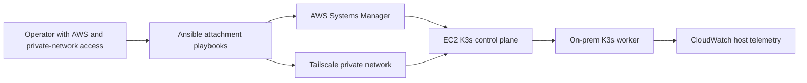

# Host And Cluster Foundation

## Purpose

The platform uses a small hybrid runtime: an ARM64 EC2 control-plane host and
an optional on-prem Linux worker. Ansible owns the on-prem host lifecycle and
its attachment to the selected environment. It does not own application
manifests or release selection.

## Attachment Model

The attach path prepares the host, registers it through a short-lived SSM
hybrid activation, resolves the selected control plane, obtains a short-lived
K3s bootstrap token, and joins the worker. Detach and decommission remove the
environment association rather than deleting application data.

## Host Responsibilities

The Ansible repository owns:

- required host packages and system configuration;
- SSM managed-node registration and deregistration;
- CloudWatch agent installation and basic host metrics;
- kubelet ECR credential support;
- K3s worker join and detach behavior;
- Tailscale-backed Flannel route validation and recovery;
- AWS credential health checks for the attached environment;
- host-local attachment state.

It does not own:

- backend or frontend images;
- Helm templates or Kubernetes manifests;
- Argo CD configuration;
- control-plane bootstrap;
- database storage lifecycle.

## Node Classes

The control plane hosts the runtime services required for the application to
function, including Redis and the API. The on-prem worker is a preferred home
for non-critical, throughput-oriented workloads such as queue drainers, ladder
refresh, and recurring jobs. Workload placement is a resilience and cost
choice, not an assumption that the worker is always available.

## Recovery Posture

An attached host has two lightweight recovery protections: a K3s network
validation path and an AWS credential health timer. These can repair a transient
network or credential condition without silently creating a new SSM
registration. If the host is intentionally moved between staging and
production, the normal detach and attach path remains the guardrail.

The cluster can continue to serve core API and database-backed behavior when
the optional worker is unavailable. Background freshness and queue throughput
are degraded until the worker is repaired or reattached.
