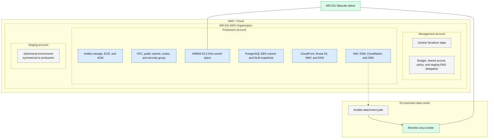
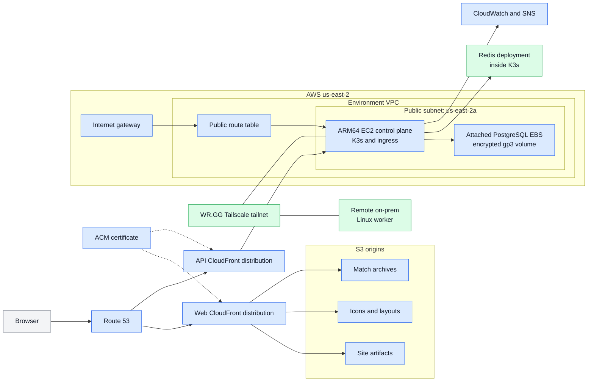

# Infrastructure Resource Topology

## Purpose

This document describes the declared production infrastructure at the resource
level. It complements the higher-level [Infrastructure](infrastructure.md)
overview by showing the AWS accounts, regional resources, network shape,
storage, delivery surfaces, and operational services that support WR.GG.

The document is a code-derived architecture summary rather than a live AWS
inventory. It intentionally omits account IDs, ARNs, bucket names, hostnames,
state locations, and other operator-specific identifiers.

Production is the reference shape. Staging uses the same major resource
composition in a separate account, with smaller storage and environment-specific
identity, domains, credentials, data, and release settings.

## Resource Containment

The account boundaries describe ownership. The resource groups inside each
environment account describe the major Terraform compositions rather than every
individual AWS resource.

### Diagram Legend

The diagrams in this document use the shared architecture palette:

| Color | Meaning |
| --- | --- |
| Gray | Neutral actors, boundaries, orchestration, and configuration concepts |
| Green | WR.GG-owned workload runtime and private-network components |
| Blue | AWS-hosted infrastructure |
| Red | External services outside WR.GG's ownership |

## Account And Regional Placement

| Scope | Declared placement | Primary responsibility |
| --- | --- | --- |
| Management | `us-east-2` management account | Central Terraform state access policy, billing budget, and cross-account bootstrap support |
| Production | `us-east-2` production account | Production network, control plane, database storage, artifact storage, registries, and runtime delivery resources |
| Staging | `us-east-2` staging account | The same major environment shape for isolated testing and release validation |
| CloudFront and certificate services | Global CloudFront services with supporting `us-east-1` provider resources | Public edge delivery, CloudFront certificates, WAF resources, and flat-rate plan integration |

The current production and staging runtime roots both declare the same primary
network shape:

- one VPC with CIDR `10.10.0.0/16`;
- one public subnet with CIDR `10.10.1.0/24` in `us-east-2a`;
- one internet gateway and public route table;
- one control-plane security group with public HTTP and HTTPS ingress;
- one ARM64 `t4g.large` EC2 control plane; and
- one attached PostgreSQL EBS volume in the same availability zone.

The single-AZ, public-subnet design is intentional for the current small
operating footprint. It provides a simple recovery path and low infrastructure
cost rather than multi-AZ high availability. No private subnet, NAT gateway,
or managed load balancer is declared in the current environment shape.

## Network And Compute

The network module intentionally remains small:

| Resource | Production shape | Role |
| --- | --- | --- |
| VPC | `10.10.0.0/16` | Environment network boundary |
| Public subnet | `10.10.1.0/24` in `us-east-2a` | Hosts the EC2 control plane |
| Internet gateway | One per environment VPC | Public ingress and outbound path for the control plane |
| Route table | One public route table and subnet association | Routes internet traffic through the gateway |
| Security group | TCP 80 and 443 from the internet; unrestricted outbound traffic | Public web/API ingress while cluster and worker coordination use the private path |
| Elastic IP | One associated with the control plane | Stable API origin and operational address |
| EC2 instance | ARM64 Amazon Linux, `t4g.large` | K3s control plane and core cluster services |
| Root EBS volume | Encrypted gp3, 30 GiB | EC2 operating system and host data |
| Database EBS volume | Encrypted gp3, 75 GiB production and 50 GiB staging | PostgreSQL data mounted separately from the application host root volume |

The on-premises host is a K3s worker. Ansible prepares it, uses the
environment's SSM hybrid activation and Tailscale path, and attaches it to the
selected control plane. It is reserved for non-critical throughput and
background-processing workloads.

## Storage And Artifact Resources

The bootstrap artifact-storage module creates private S3 buckets with
server-side encryption and public-access blocking. CloudFront reads the public
web origins through Origin Access Control rather than exposing the buckets
directly.

| Resource | Purpose | Lifecycle and access shape |
| --- | --- | --- |
| Site artifacts | React bundles, static pages, SEO HTML, `sitemap.xml`, and `ads.txt` | Versioned; CloudFront web origin; release objects expire after approximately 30 days |
| Dashboard artifacts | Private dashboard release bundles and related artifacts | Versioned; retained through the dashboard release lifecycle; not a public site origin |
| Icons and layouts | Champion, item, spell, profile, and layout assets | Non-versioned; CloudFront origin under `/icons/*` and `/layouts/*` |
| Job workspace | Temporary worker output and S3 inventory reports | Non-versioned; temporary workspace expires after 7 days and inventory reports after 30 days |
| Match archives | Compressed match JSON served to the frontend | Non-versioned; application retention is based on match age, with a 120-day upload-age safety net and weekly inventory |
| Timeline data | Private timeline and training data | Non-versioned; incomplete multipart uploads expire after 7 days |
| EC2 bootstrap | Versioned user-data/bootstrap script | Private object read by the control-plane instance profile |

The database volume is managed separately from the application runtime. Its
Terraform module uses a `prevent_destroy` guard, supports controlled adoption or
restore, and applies a daily EBS snapshot policy retaining seven snapshots by
default. The current snapshot schedule is `03:00` UTC.

## Container Artifact Resources

Each environment has immutable ECR repositories for:

- the backend API image;
- the backend worker image; and
- the private dashboard image.

Repositories scan images on push. Untagged images expire after approximately
one day, while each repository keeps the most recent 20 release-tagged images.
The production bootstrap also grants narrowly scoped promotion reads for the
release workflows that need to promote or inspect artifacts.

## Public Delivery And DNS

The delivery layer has separate web and API CloudFront distributions:

| Surface | Origin | Important behavior |
| --- | --- | --- |
| Web distribution | Site, icon/layout, and match-archive S3 origins | HTTPS redirect, optimized static caching for assets, CORS for asset/archive paths, and a CloudFront function for SPA and generated SEO routing |
| API distribution | EC2 control-plane origin | Caching disabled by default; selected analytics and leaderboard paths use origin cache-control behavior; maintenance mode can return a small 503 response at the edge |

AWS Certificate Manager issues the environment certificate and wildcard in
`us-east-1`, with DNS validation through the environment's Route 53 zone.
Route 53 records provide the public web and API aliases and the staging DNS
delegation path.

When the flat-rate CloudFront plan is enabled, Terraform also creates the
associated CloudFormation subscription and CloudFront-scoped WAF resources.
The current WAF configuration provides CloudWatch metrics and sampled requests
with an allow-by-default action; it is an attached edge capability rather than
the application's primary rate-limiting system.

## Identity And Operations

The infrastructure uses separate roles for separate access paths:

- the EC2 instance profile provides SSM management, ECR image pulls, and
  narrowly scoped access to required S3 artifacts;
- the SSM hybrid managed-node role supports the on-prem host;
- GitHub Actions roles publish frontend artifacts, backend images, and the
  dashboard image without storing long-lived repository credentials;
- the control plane and selected worker workloads receive only the S3 access
  needed for their job; and
- CloudWatch alarms notify through SNS for EC2 health, CPU, EBS queue and
  throughput pressure, and host disk usage.

EBS encryption is enabled by default in each environment account, individual
EBS volumes are encrypted, and S3 buckets use server-side encryption. Public
web traffic is handled by CloudFront; cluster and worker coordination uses
Tailscale rather than public Kubernetes control-plane exposure.

## Terraform Composition

The infrastructure is split into reusable modules and environment-specific
roots:

| Layer | Main responsibility |
| --- | --- |
| Bootstrap roots | Establish account-level encryption defaults, artifact buckets, ECR repositories, GitHub Actions publishing roles, certificates, DNS zones, state access, and billing controls |
| `00-db-storage` live root | Create or adopt the PostgreSQL EBS volume and its snapshot lifecycle |
| `01-core` live root | Compose the VPC, control plane, API delivery, and API DNS records |
| `02-web-distribution` live root | Compose the web CloudFront distribution, S3 origin policies, and web DNS records |
| Versioned Terraform modules | Provide the reusable network, control-plane, storage, delivery, DNS, certificate, registry, and publishing-role primitives |

Terraform owns the declared AWS resource state. EC2 user data creates the first
K3s control-plane path, while Kubernetes and Argo CD later own cluster resource
reconciliation. Ansible owns the worker host and its environment
attachment. Application image selection belongs to the Kubernetes desired-state
repository and release workflows rather than to this infrastructure layer.

## Deliberate Tradeoffs

- One public subnet and one availability zone keep the deployment inexpensive
  and easy to recover, but do not provide multi-AZ infrastructure resilience.
- Separate database EBS storage allows the database lifecycle, snapshots, and
  recovery operations to remain independent from EC2 replacement.
- CloudFront separates public edge delivery from the API origin and keeps S3
  buckets private behind Origin Access Control.
- The on-prem worker adds throughput without becoming a dependency for the API
  or primary data services.
- Staging mirrors the production resource shape so deployment behavior can be
  tested without maintaining a second infrastructure design.
