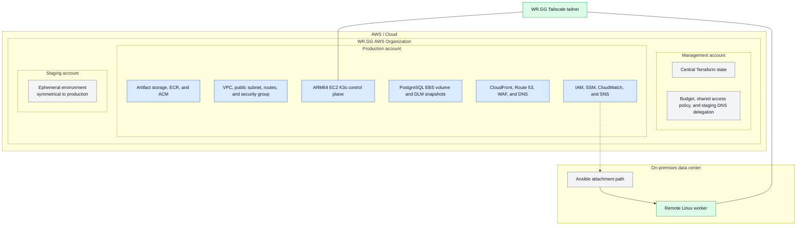
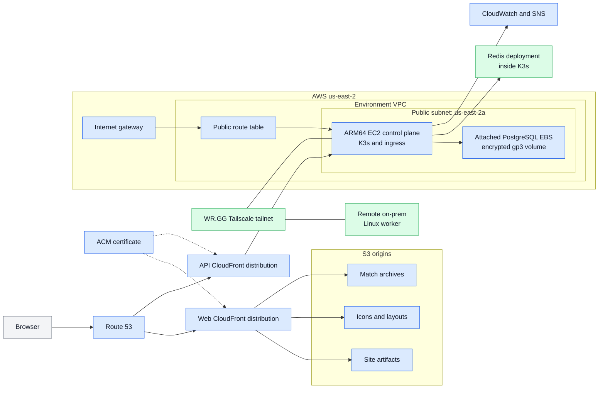

# AWS & On-Prem Resources

## High Level Overview

This document describes the declared production infrastructure at the resource
level. It complements the higher-level [Infrastructure](infrastructure.md)
overview by showing the AWS accounts, regional resources, network shape,
storage, delivery surfaces, and operational services that support WR.GG.

## Resource Containment

The account boundaries describe ownership. The resource groups inside each
environment account describe the major Terraform compositions rather than every
individual AWS resource.

### Diagram Legend

The diagrams in this document use the shared architecture palette:

| Color | Meaning |
| --- | --- |
| Gray | Neutral actors, boundaries, orchestration, and configuration concepts |
| Green | WR.GG-owned workload runtime and private-network components |
| Blue | AWS-hosted infrastructure |
| Red | External services outside WR.GG's ownership |

## Account And Regional Placement

| Scope | Declared placement | Primary responsibility |
| --- | --- | --- |
| Management | `us-east-2` management account | Central Terraform state access policy, billing budget, and cross-account bootstrap support |
| Production | `us-east-2` production account | Production network, control plane, database storage, artifact storage, registries, and runtime delivery resources |
| Staging | `us-east-2` staging account | The same major environment shape for isolated testing and release validation |
| CloudFront and certificate services | Global CloudFront services with supporting `us-east-1` provider resources | Public edge delivery, CloudFront certificates, WAF resources, and flat-rate plan integration |

The single-AZ, public-subnet design is intentional for the current small
operating footprint. It provides a simpler ops and low infrastructure
cost rather than a multi-AZ high availability deployment. For this same reason an EIP is used to route to the control plane rather than a managed load balancer.

## Network And Compute

| Resource | Production shape | Role |
| --- | --- | --- |
| VPC | `10.10.0.0/16` | Environment network boundary |
| Public subnet | `10.10.1.0/24` in `us-east-2a` | Hosts the EC2 control plane |
| Internet gateway | One per environment VPC | Public ingress and outbound path for the control plane |
| Route table | One public route table and subnet association | Routes internet traffic through the gateway |
| Security group | TCP 80 and 443 from the internet; unrestricted outbound traffic | Public web/API ingress while cluster and worker coordination use the private path |
| Elastic IP | One associated with the control plane | Stable API origin and operational address |
| EC2 instance | ARM64 Amazon Linux, `t4g.large` | K3s control plane and core cluster services |

The on-premises host is a K3s worker. Ansible prepares it, uses the
environment's SSM hybrid activation and the Tailscale API, and attaches it to the
selected control plane. It is reserved for non-critical workloads.

## EBS Volumes

EBS provides separate storage for the control-plane host and PostgreSQL. The
database volume has its own lifecycle so database recovery does not depend on
replacing the EC2 instance.

| Volume | Contents | Lifecycle and recovery |
| --- | --- | --- |
| Root volume | EC2 operating system and host data | Encrypted gp3, `minimal` GBs; attached to the control-plane instance |
| Database volume | PostgreSQL data | Encrypted gp3, `more` GBs in production and `fewer` GBs in staging; `prevent_destroy`, controlled adoption/restore, and one daily DLM snapshot around `03:00` UTC with the seven most recent retained |

## On-Prem Resources

The on-premises resource is a reclaimed Dynabook Portégé X30-F Windows laptop. Windows
was replaced with Ubuntu Linux. The machine is largely responsible for running workloads that previously were performed in AWS Lambda and EC2.

The host has an 8th-generation Intel Core i5 vPro processor with 4 physical
cores, 8 logical threads, and 16 GB of RAM (that much RAM on an EC2 instance would be quite expensive).

Ansible prepares the host, installs the required agents and packages, manages
its SSM and Tailscale integration, and attaches or detaches it from the target
cluster.

## Object Storage

The bootstrap artifact-storage module creates private S3 buckets with
server-side encryption and public-access blocking. CloudFront reads the public
web origins through Origin Access Control rather than exposing the buckets
directly.

| S3 store or object group | Contents | Important notes |
| --- | --- | --- |
| Site artifacts | React bundles, static pages, SEO HTML, `sitemap.xml`, and `ads.txt` | Versioned CloudFront web origin; release objects expire after approximately 30 days |
| Dashboard artifacts | Private dashboard release bundles and related artifacts | Versioned and retained through the dashboard release lifecycle; not a public site origin |
| Icons and layouts | Champion, item, spell, profile, and layout assets | Non-versioned CloudFront origin under `/icons/*` and `/layouts/*` |
| Job workspace | Temporary S3 staging objects, SEO artifacts, and S3 Inventory reports | Private and non-versioned; `temporary/` expires after 7 days, inventory reports after 30 days, and other prefixes are managed separately |
| Match archives | Compressed match JSON served to the frontend | Non-versioned; application retention is based on match age, with a 120-day upload-age safety net and weekly inventory |
| EC2 bootstrap | Versioned user-data/bootstrap script | Private object read by the control-plane instance profile |

## ECR

Each environment has immutable ECR repositories for the deployable container
artifacts:

| Repository | Contents | Important notes |
| --- | --- | --- |
| Backend API | FastAPI application and its API runtime | Scans images on push; release tags are retained for promotion and rollback |
| Backend worker | Match, ladder, maintenance, and other background worker runtime | Scans images on push; release tags are retained for promotion and rollback |
| Dashboard | Private dashboard web server image | Scans images on push; release tags are retained for dashboard deployment and rollback |

Untagged images expire after approximately one day, while each repository keeps
the most recent 20 release-tagged images. The production bootstrap also grants
narrowly scoped promotion reads for release workflows that need to promote or
inspect artifacts.

## Public Delivery And DNS

The delivery layer has separate web and API CloudFront distributions:

| Surface | Origin | Important behavior |
| --- | --- | --- |
| Web distribution | Site, icon/layout, and match-archive S3 origins | HTTPS redirect, optimized static caching for assets, CORS for asset/archive paths, and a CloudFront function for SPA and generated SEO routing |
| API distribution | EC2 control-plane origin | Caching disabled by default; selected analytics and leaderboard paths use origin cache-control behavior; maintenance mode can return a small 503 response at the edge |

AWS Certificate Manager issues the environment certificate and wildcard in
`us-east-1`, with DNS validation through the environment's Route 53 zone.
Route 53 records provide the public web and API aliases and the staging DNS
delegation path.

When the flat-rate CloudFront plan is enabled, Terraform also creates the
associated CloudFormation subscription and CloudFront-scoped WAF resources.
The current WAF configuration provides CloudWatch metrics and sampled requests
with an allow-by-default action; it is an attached edge capability rather than
the application's primary rate-limiting system.

## Access And Operations

The infrastructure uses separate roles for separate access paths:

- EC2 instance profile provides SSM management, ECR image pulls, and
  narrowly scoped access to required S3 artifacts
- The SSM hybrid managed-node role supports the on-prem host
- GitHub Actions roles publish frontend artifacts, backend images, and the
  dashboard image without storing long-lived repository credentials
- The control plane and selected worker workloads receive only the S3 access
  needed for their job
- CloudWatch alarms notify through SNS for EC2 health, CPU, EBS queue and
  throughput pressure, and host disk usage

EBS encryption is enabled by default in each environment account, individual
EBS volumes are encrypted, and S3 buckets use server-side encryption. Cluster and worker coordination uses
Tailscale rather than public Kubernetes control-plane exposure or the AWS private network.

## Terraform Composition

The infrastructure is split into reusable modules and environment-specific
roots:

| Layer | Main responsibility |
| --- | --- |
| Bootstrap roots | Establish account-level encryption defaults, artifact buckets, ECR repositories, GitHub Actions publishing roles, certificates, DNS zones, state access, and billing controls |
| `00-db-storage` live root | Create or adopt the PostgreSQL EBS volume and its snapshot lifecycle |
| `01-core` live root | Compose the VPC, control plane, API delivery, and API DNS records |
| `02-web-distribution` live root | Compose the web CloudFront distribution, S3 origin policies, and web DNS records |
| Versioned Terraform modules | Provide the reusable network, control-plane, storage, delivery, DNS, certificate, registry, and publishing-role primitives |

Terraform owns the declared AWS resource state. EC2 user data creates the first
K3s control-plane path, while Kubernetes and Argo CD later own cluster resource
reconciliation. Ansible owns the worker host and its environment
attachment. Application image selection belongs to the Kubernetes desired-state
repository and release workflows rather than to this infrastructure layer.

## Design Choices

- One public subnet and one availability zone keep the deployment inexpensive
  and easy to recover, but do not provide multi-AZ infrastructure resilience.
- Separate database EBS storage allows the database lifecycle, snapshots, and
  recovery operations to remain independent from EC2 replacement.
- CloudFront separates public edge delivery from the API origin and keeps S3
  buckets private behind Origin Access Control.
- The on-prem worker adds computing capacity without becoming a dependency for the API
  or primary data services.
- Staging mirrors the production resource shape so deployment behavior can be
  tested without maintaining a second infrastructure design.
