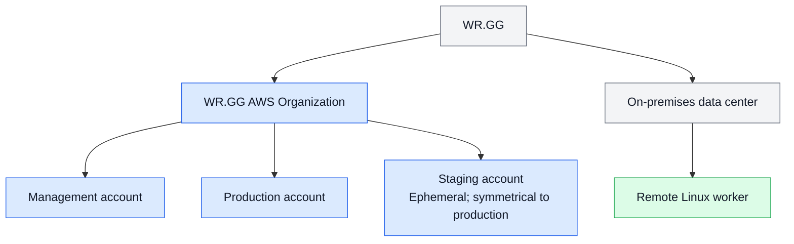
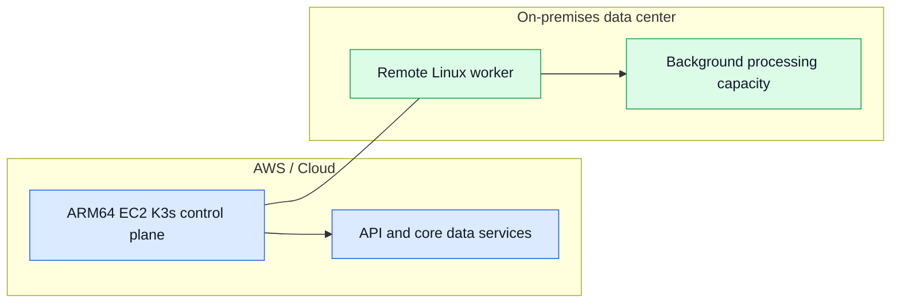
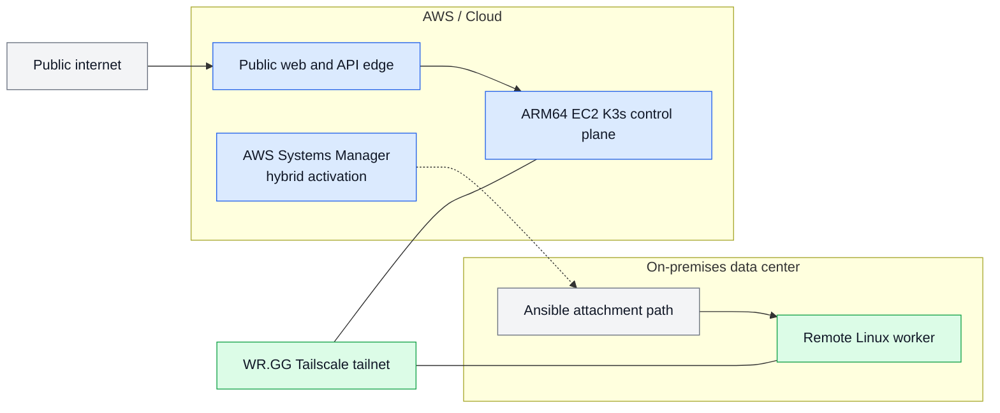

# Infrastructure

## High Level Overview

WR.GG is built on hybrid cloud infrastructure, partly to demonstrate skills in
solution architecture and partly to save on infrastructure costs. Terraform
(IaC) owns AWS resources and state. Ansible owns the on-prem worker's host
lifecycle and its integration with either the production or staging
environment.

## AWS Organization Chart

By design, Production and Staging use the same shape in separate accounts with
different identity, credentials, domains, data, and scale preferences.

## Hybrid Cloud Shape

The ARM64 EC2 host runs the K3s control plane and the critical components required for
core application behavior. The on-premises Linux host joins the cluster as a
worker for non-critical, but high value recurring workloads.

The two hosts form one logical cluster for the selected environment. The AWS
control plane carries the API and core data services. The on-premises worker
provides additional capacity for background processing and can be attached to
staging or production but not both simulatensouly.

## Hybrid Network

The public internet (end user) reaches the AWS control plane. The private worker path uses
AWS Systems Manager for registration and Ansible for host preparation and
attachment. Tailscale is the WR.GG-controlled private network spanning the
AWS control plane and the on-premises worker.

Ansible prepares the worker, registers it through a short-lived SSM hybrid
activation, validates the Tailscale network, obtains the selected K3s join
information, and attaches it to the target environment.

## Resource Details

The detailed production resource inventory is documented in
[Infrastructure Resource Topology](infrastructure-resources.md). It covers the Terraform managed, AWS-deployed networking, compute, storage, monitoring and computing solution
