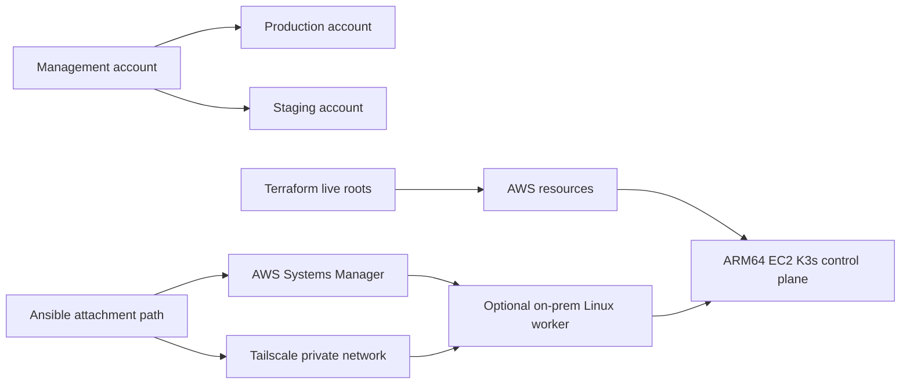

# Infrastructure

## Purpose

Infrastructure provides the cloud, network, storage, host, and access
foundations that the application runs on. Terraform owns AWS resources and
state. Ansible owns the optional on-prem worker's host lifecycle and its
attachment to the selected environment. Neither system builds application
artifacts or selects the application release that is running.

## Production Shape

Production is the reference architecture. Staging uses the same shape in a
separate account with different identity, credentials, domains, data, and
operational scale. It is an environment overlay, not a second platform
design.

## AWS Foundation

Versioned Terraform modules define reusable resource primitives. Environment-
specific live roots compose those modules and own their remote state. The
production resource concerns include:

- account and IAM boundaries;
- VPC, subnets, security groups, and the control-plane host;
- EBS database storage and snapshot lifecycle;
- S3 buckets for public content, match archives, and release artifacts;
- CloudFront distributions, certificates, hosted zones, and DNS records;
- ECR repositories for backend and dashboard images; and
- CloudWatch metrics, alarms, and operational notifications.

The exact account identifiers, names, addresses, and state locations are not
part of this public documentation.

## Host And Network Boundary

The ARM64 EC2 host runs the K3s control plane and the services required for
core application behavior. An optional on-prem Linux host joins the cluster as
a worker for non-critical, throughput-oriented workloads such as queue
draining, ladder refresh, and recurring jobs.

Ansible prepares the worker, registers it through a short-lived SSM hybrid
activation, validates the private Tailscale network, obtains the selected K3s
join information, and attaches it to the target environment. Detach and
reattach are explicit operations when moving the host between staging and
production.

The worker is not assumed to be permanently available. If it is unavailable,
the API and core data services remain the primary recovery target while
background freshness and throughput are degraded.

## Durable Storage

PostgreSQL uses an EBS volume whose lifecycle is separate from the application
runtime. A normal infrastructure change may adopt an existing volume or use an
explicit restore source. Volume replacement, snapshot restore, and destructive
volume or snapshot deletion are separate guarded operations.

S3 stores match archives, static assets, frontend releases, and generated SEO
objects. CloudFront provides the public edge delivery layer for those objects.
Redis is runtime coordination state rather than durable product storage; its
behavior is described with the backend and Kubernetes concerns.

## Source Of Truth And Failure Boundary

Terraform state answers what AWS infrastructure is currently owned. The live
root and selected module version answer how that infrastructure is composed.
Ansible attachment state answers how the on-prem worker is prepared and joined.

Infrastructure failure can make the cluster, network, storage, or optional
worker unavailable, but infrastructure does not decide which application
artifact is healthy. Application release selection and rollback belong to
[CI/CD and release](ci-cd.md), while runtime reconciliation belongs to
[Kubernetes runtime](kubernetes-runtime.md).
