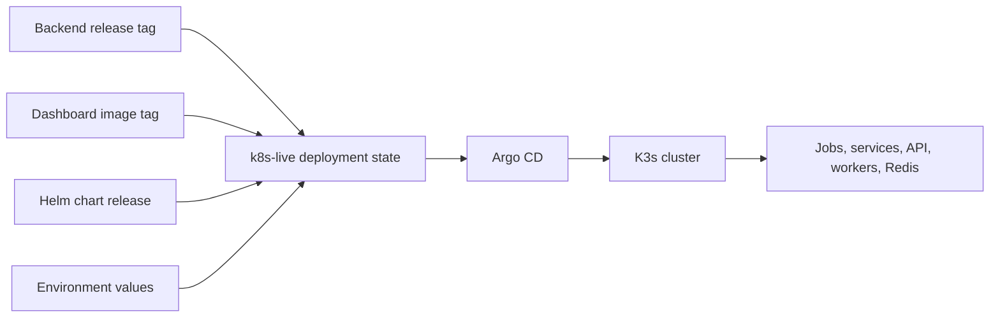

# Kubernetes Delivery

## Purpose

Kubernetes delivery has two separate responsibilities:

- Helm defines how the runtime is rendered.
- `k8s-live` defines which immutable releases an environment requests.

Argo CD reconciles that desired state into the K3s cluster. Neither repository
builds application images.

## Delivery Flow



## Helm Responsibility

The runtime chart renders the API, worker deployments, Redis, initialization
jobs, recurring CronJobs, services, service accounts, and ingress. Environment
values explicitly provide runtime identity, image repositories and tags, Riot
rate-limit profile, enabled metrics, data policies, and deployment scope.

The chart owns the platform catalog and derives platform workers from selected
regional scope. This avoids repeating the same region-to-platform mapping at
every application call site while keeping environment choices explicit.

The bootstrap chart is separate from the runtime chart. It establishes cluster
support resources and private ingress prerequisites. The runtime chart then
renders application resources against that foundation.

## Reconciliation Order

The runtime uses ordered sync waves so a fresh environment can become usable
without relying on manual command sequencing:

```text
database migration       wave 10
database seed             wave 20
partitions and row data   wave 30
initial asset refreshes   waves 40-50
Redis                     wave 60
runtime workers           wave 70
API and dashboard         wave 80
recurring reconciliation  wave 90
```

The exact resource names are implementation details. The important contract is
that schema and reference data precede workloads, and recurring jobs are not
mistaken for one-time initialization.

## Desired Versus Observed State

The environment deployment file is the requested state. Argo health and
Kubernetes status are the observed state. A healthy cluster can still be
out-of-sync if the desired revision changed, and a synced application can
still expose a failing workload if the selected image or runtime dependency
is unhealthy. This separation makes diagnosis possible rather than collapsing
every problem into a single deployment status.

## Failure And Rollback

An image or chart rollback changes the selected immutable cluster revision and
lets Argo reconcile it. It does not rebuild the artifact, replace the control
plane, or destroy the database volume. Control-plane replacement and database
restore are separate recovery concerns documented in [Infrastructure](infrastructure.md)
and [CI/CD and release](ci-cd.md).
