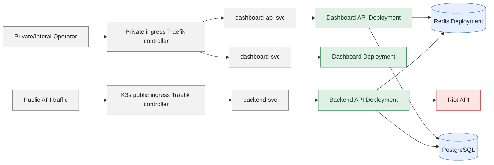
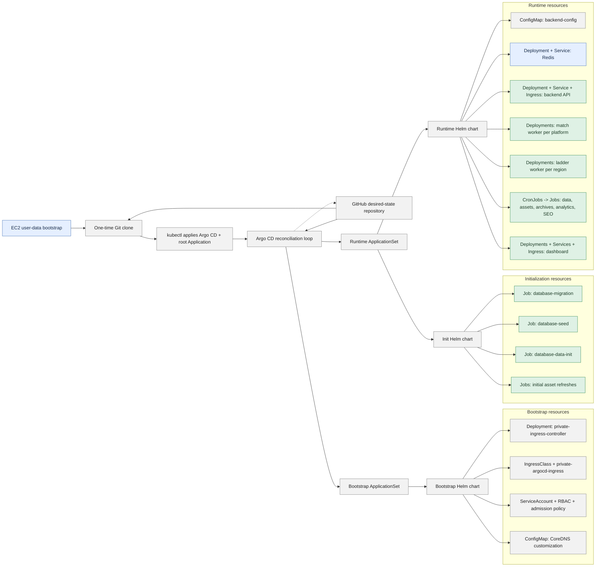
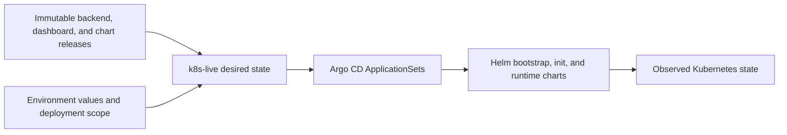

# Kubernetes Runtime

## Purpose

Kubernetes (K3s cluster) is the container orchestration layer for WR.GG. It turns
immutable images and Helm templates into a running cluster, schedules workloads
across hybrid-cloud nodes (AWS and an On-Prem data cener), and continually works to keep cluster state aligned
with desired state.

The responsibilities are split across multiple concerns:

- Terraform and Ansible provide the cloud, host, network, storage, and access
  foundations.
- `INTERNAL_REPOSITORY_1` defines Helm charts, defining the Kubernetes resources and their relationships.
- `INTERNAL_REPOSITORY_2` supplies the desired state and release selections.
- EC2 user data provides the initial bootstrap gateway: it installs K3s and Argo
  CD, clones the desired-state repository, and applies the root Argo resources.
- Argo CD then renders the selected Helm sources and reconciles them into the
  cluster.

This document explains the primary cluster resource model and runtime behavior. The
`backend` document explains application request and data flows; the CI/CD
document explains how artifacts and desired state are published.

### Diagram Legend

The diagrams in this document use the shared architecture palette:

| Color | Meaning |
| --- | --- |
| Gray | User-facing actors or boundaries |
| Green | Highlighted WR.GG application code/workload runtime (AWS or on-prem; see [Infrastructure](infrastructure.md)) |
| Blue | AWS-hosted infrastructure |
| Red | External services outside WR.GG's ownership |

## Bootstrap Gateway And Reconciliation

The cluster has a one-time bootstrap path and a separate steady-state
reconciliation path. They are related, but they are not the same mechanism.

During control-plane bootstrap, EC2 user data downloads the full bootstrap
script from the environment's S3 bootstrap bucket, installs and starts K3s,
retrieves the required credentials from SSM, and clones the GitHub desired-state
repository to the control-plane host. It then uses `kubectl` to apply the Argo
CD installation, repository credentials, and the environment's root
`Application`.

This is the initial gateway that makes Argo possible. The local repository clone
is a bootstrap workspace containing manifests; it is not the application runtime
and it is not the ongoing deployment engine. EC2 user data does not render the
full application itself.

Once Argo CD and the root `Application` exist, Argo's repo-server fetches the
remote desired-state repository itself. The root `Application` loads the
environment overlay, which creates the `ApplicationSet` resources. Those
`ApplicationSet` resources generate the bootstrap and runtime Argo
`Application`s, and Argo renders the pinned Helm charts and applies the
resulting Kubernetes resources.

Normal application changes therefore do not require EC2 to clone or apply the
repository again. CI updates the desired state or release selection in GitHub,
and Argo reconciles the existing cluster. Replacing the control-plane host
repeats the bootstrap gateway, after which Argo reconstructs the selected
cluster state from the remote repository.

## Cluster Network Boundary

This first diagram is a highlevel networking overview. It shows how public API traffic and
private operator traffic enter the cluster, the primary Services receive that
traffic, and which runtime dependencies those workloads use. It is not a
complete inventory of Kubernetes resources. See next diagram.



The public API uses the cluster's public ingress path, largely standard & bundled with K3s, and routes through a
ClusterIP Service to the backend API pod(s). WR.GG has a supporting traffic & health private dashbaord that is accessed through a separate
private IngressClass and private ingress controller.

Redis is runtime coordination & state management system
for rate limiting, Riot Games (external) API Health observations, and dashboard metrics. PostgreSQL is
durable product data and runs outside of the cluster. S3 is the durable object boundary for match
archives, static assets, releases, and generated SEO content. These external
systems are shown here only to clarify the cluster boundary; their ownership
and lifecycle are documented in [Infrastructure](infrastructure.md).

## Cluster Resource Composition

The network diagram explains how traffic moves. This is the primary
cluster-design view. It shows the initial EC2 bootstrap gateway, the Argo
resources that take over reconciliation, and how the Helm layers render into
the cluster.



The first path is the initial control-plane bootstrap: EC2 user data clones the
desired-state repository and uses `kubectl` to install Argo CD and apply the
root `Application`. The steady-state relationship begins once Argo exists: Argo's
repo-server reads the remote repository, compares it with observed cluster
state, and reconciles the difference. The dashed edge represents that repeated
fetch-and-compare loop; it does not write changes back to GitHub. The EC2-local
clone is not the ongoing source of reconciliation.

The bootstrap chart is a separate cluster-support Application. The runtime
ApplicationSet supplies two Helm sources: the initialization chart for finite
Jobs and the runtime chart for steady-state workloads. The environment values
and selected release tags are supplied by `k8s-live`; they are not inferred by
the chart.

The chart also consumes an environment Secret for credentials. That Secret is
part of the cluster's environment contract but is intentionally not generated
by this public documentation's Helm diagram.

## Namespaces And Foundations

The cluster uses a small number of meaningful boundaries rather than a
namespace for every workload:

| Boundary | Main responsibility |
| --- | --- |
| `argocd` | Argo CD and the private Argo ingress surface |
| `private-ingress` | The private Traefik controller, its ServiceAccount, and cluster-scoped read permissions |
| `<environment>` | The application ConfigMap, Secrets, Services, Deployments, initialization Jobs, and recurring CronJobs |
| `kube-system` | K3s system services, including the CoreDNS customization used by the private network |

The bootstrap layer creates the private ingress controller, its
`IngressClass`, RBAC, private Argo Ingress, and the CoreDNS configuration
needed for private host resolution. The runtime Application creates the
selected environment namespace. Bootstrap also constrains AWS
credential-bearing workloads through cluster admission policy and a dedicated
runtime ServiceAccount.

The public API ingress is distinct from the private ingress path. The public
API is addressed through its environment hostname and the cluster's normal
web entrypoint. Argo and the dashboard use the private entrypoint instead.

## Workload Model

The runtime is composed from a small set of Kubernetes resource types. Each type
has a different lifecycle and should not be treated as interchangeable.

| Resource type | WRGG role | Lifecycle |
| --- | --- | --- |
| `Deployment` | Backend API, Redis, per-platform match workers, per-region ladder workers, dashboard, and dashboard API | Continuously maintains the requested pod count |
| `Job` | Database migration, seed, data initialization, and initial asset refresh | Finite release or environment initialization task |
| `CronJob` | Data refresh, icon refresh, archive reconciliation and cleanup, derived analytics, and SEO publication | Creates finite Jobs on a schedule; overlapping runs are forbidden |
| `Service` | Stable in-cluster names for the backend, Redis, dashboard, and dashboard API | ClusterIP routing to selected pods |
| `Ingress` | Public API routing and private dashboard/Argo routing | HTTP boundary from the relevant cluster entrypoint to a Service |
| `ConfigMap` | Non-secret environment identity, deployment scope, runtime policy, and tuning | Shared configuration rendered by Helm |
| `Secret` | Riot credentials, database credentials, and other sensitive runtime values | Mounted or injected only into workloads that need them |

The worker image is shared by the match worker, ladder worker, initialization
Jobs, and CronJobs. The API image is used by the API, database migration, seed,
and dashboard API workloads. These are separate runtime roles even when they
are published from the same backend release.

## Helm Layers

The chart repository separates cluster prerequisites, finite initialization,
and steady-state runtime.

### Bootstrap Chart

The bootstrap chart installs resources that support the cluster and private
operator path:

- private Traefik ingress controller;
- private `IngressClass` and Argo ingress;
- ServiceAccount, ClusterRole, and ClusterRoleBinding for ingress discovery;
- CoreDNS customization for the private network; and
- cluster admission policies for AWS credential mounts.

The bootstrap ApplicationSet is reconciled before the environment application.
It is cluster support, not an application release.

### Initialization Chart

The initialization chart renders finite Jobs using the exact backend release
selected by `k8s-live`:

- database migration;
- database seed;
- partition and reference-data initialization; and
- initial icon refreshes.

These Jobs are intentionally separate from the long-running runtime. A failed
initialization Job is a failed prerequisite to investigate, not a reason to
start an incomplete API stack and hope that later reconciliation repairs it.

### Runtime Chart

The runtime chart renders the shared ConfigMap, Redis, API, workers, dashboard,
Services, Ingress resources, and recurring CronJobs. Runtime values explicitly
select the environment identity, image repositories and tags, deployment scope,
New Destiny settings, data retention policy, worker topology, and dashboard
state.

The chart has no useful production or staging fallback for these values. Empty
required values fail rendering rather than silently selecting the wrong
environment or rate-limit profile.

## Scheduling And Placement

Placement is deliberate because the cluster is hybrid and the node classes have
different operational importance:

| Placement | Workloads | Reason |
| --- | --- | --- |
| `control-plane` | Backend API, Redis, database migration/seed/data initialization, dashboard, dashboard API, private ingress | Core availability and control-plane locality |
| `on-prem` | Match workers, ladder workers, initial asset Jobs, recurring data/icon/archive/analytics/SEO Jobs | Non-core throughput and scheduled processing |

The chart expresses this through required node affinity and matching
tolerations. It does not allow a worker workload to drift onto an unintended
node class. The optional on-prem node can be detached without taking the core
API and Redis path with it, but background throughput, refreshes, and new
initialization work will be degraded or paused.

The deployment scope is regional. `deploymentScope.regions` selects the
enabled regions; the chart derives the platform/server list from its catalog.
It renders one match-worker Deployment per selected platform and one
ladder-worker Deployment per selected region. The current production posture
uses one ladder worker per region and an explicit match-worker replica count
per platform.

This keeps the region-to-platform decision in the deployment boundary rather
than duplicating it across application call sites. The backend still validates
the same deployment scope when it receives a request.

## Initialization And Sync Order

Argo uses separate bootstrap and runtime Applications, then uses sync waves to
make dependencies visible during a fresh or updated environment:

```text
bootstrap Application       wave 0
runtime ConfigMap            wave 0
runtime ApplicationSet       wave 1
database migration           wave 10
database seed                wave 20
partitions and row data      wave 30
initial asset refreshes      waves 40-50
Redis                        wave 60
long-running workers         wave 70
API and dashboard            wave 80
recurring CronJobs           wave 90
```

The important contract is not the exact number assigned to every resource. The
contract is that schema and reference data precede workloads, Redis is present
before components that depend on it, long-running workers start after their
prerequisites, and recurring jobs are not confused with initialization.

The backend and worker pods also use Redis readiness gates during startup. This
protects them from starting their application process before the Redis Service
is reachable, but it does not make Redis highly available.

## Controllers And Reconciliation

Several control loops participate in the runtime, and they solve different
problems:

- **Argo CD** watches Git-backed desired state, renders the selected Helm
  sources, and reports application sync and health.
- **The Kubernetes scheduler** assigns pending pods to nodes that satisfy
  affinity, taints, tolerations, and resource constraints.
- **Deployment controllers** maintain the requested replica sets for the API,
  Redis, dashboard, and long-running workers.
- **Job and CronJob controllers** create and track finite processing tasks.
- **Ingress controllers** watch Ingress and Service resources and configure the
  relevant HTTP entrypoint.

Argo is therefore not the same thing as the Kubernetes scheduler, and a Helm
chart is not the same thing as a running workload. Helm renders the requested
resources; the controllers make those resources observable in the cluster.

## Failure Boundaries

The runtime intentionally has visible failure boundaries:

- A failed API Deployment affects public API availability but does not require
  rebuilding the chart or replacing the cluster host.
- A failed worker or unavailable on-prem node delays background processing and
  freshness while the control-plane API path can remain available.
- A failed initialization Job blocks the corresponding startup path until its
  image, configuration, dependency, or data issue is corrected.
- A failed CronJob affects one scheduled concern and is retained in Kubernetes
  history for diagnosis; `concurrencyPolicy: Forbid` prevents overlapping runs
  from silently competing.
- Redis loss affects coordination and rate limiting; PostgreSQL remains the
  durable product database, but the application is not designed as a fully
  independent Redis-free runtime.
- A desired-state change can be synced while the application remains degraded;
  Argo sync status and workload health must both be checked.

The current shape is a production-like early-beta cluster, not a claim of
multi-zone high availability. Core services are intentionally small and
control-plane placed. Recovery of the control-plane host, worker attachment,
PostgreSQL storage, or snapshots belongs to the infrastructure recovery path,
not to an application image rollback.

## Desired State And Release Boundary



The environment deployment file records the exact cluster, backend, chart,
and dashboard releases. A normal application change updates those pointers and
lets Argo reconcile the existing cluster. It does not rebuild an image,
replace the control plane, or destroy PostgreSQL storage.

Rollback is the inverse operation: select a previously published immutable
release and reconcile it through the same path. Control-plane replacement,
database volume adoption, snapshot restore, and destructive reset are separate
infrastructure operations.
